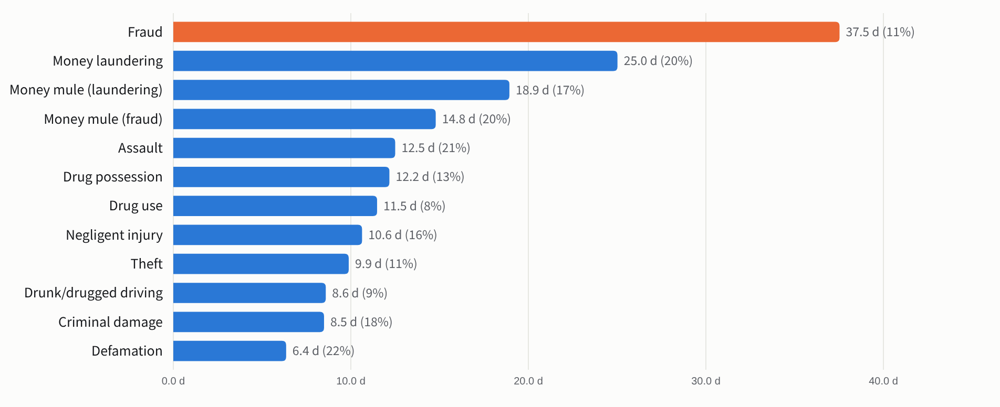
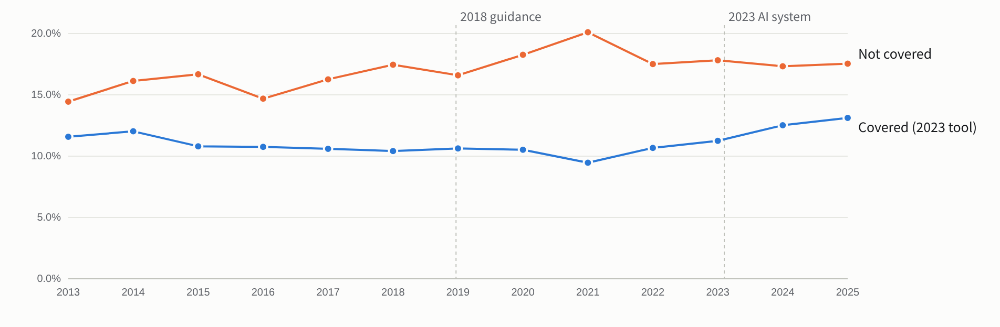
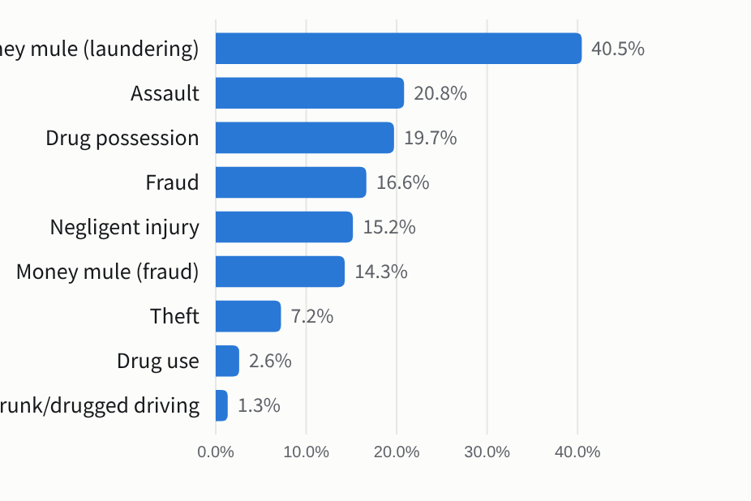
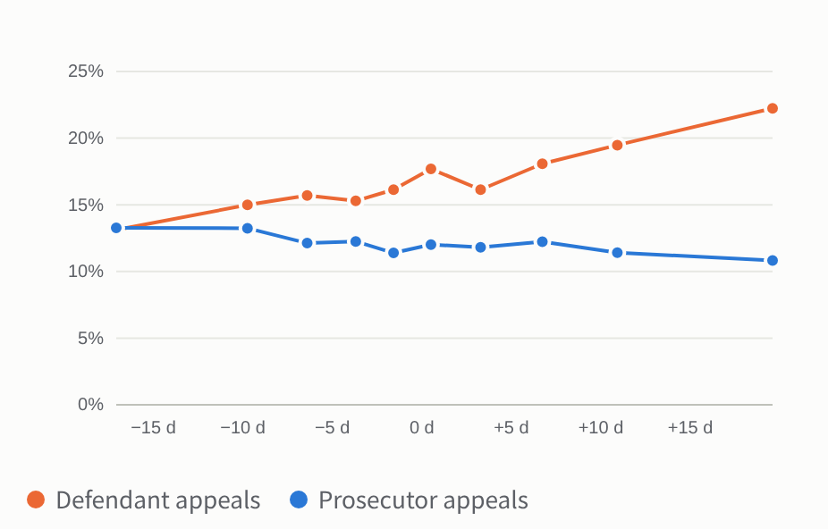
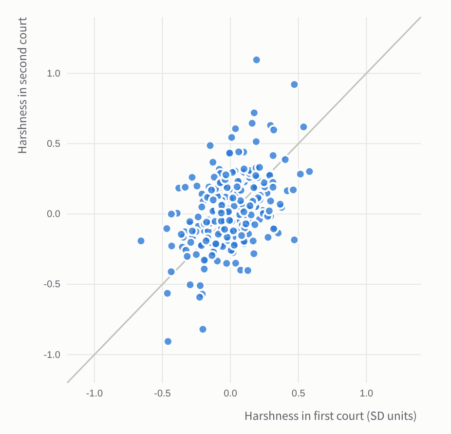
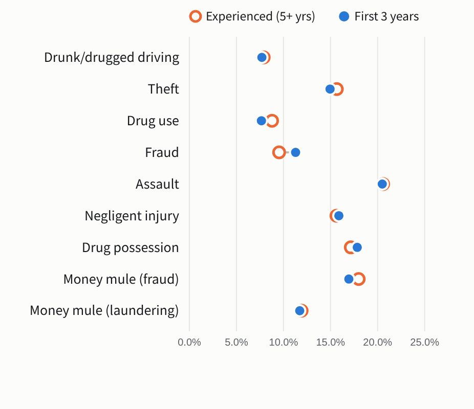
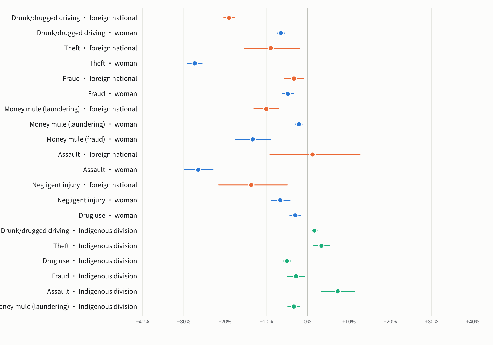
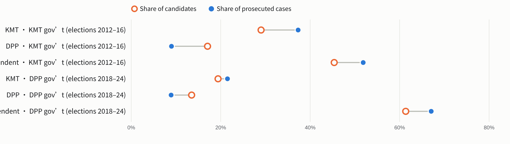

**English** · [繁體中文白話版](README.zh-TW.md)

# Same Case, Different Judge

Do criminal judgments in Taiwan follow the law and the facts, or do they also depend on who the judge is, who the defendant is, and politics? This report follows 1,560,890 first-instance criminal cases decided by single judges in all district courts from 2013 to 2026, plus 2,283 election-crime judgments, to measure how much the outcome depends on things the law says should not matter.

Data: Judicial Yuan open terminated-case microdata (終結案件資料), the judgment database (裁判書) and Central Election Commission candidate records 
Judges are named only where the safeguards in §1.3 are met 

## What we found

| Number | What it means |
|---|---|
| <b>4%–15%</b> | of the variation in prison terms that the recorded case facts do not explain is tied to which judge happened to be assigned, depending on the offence |
| <b>38 days</b> | expected gap in a fraud sentence between two randomly drawn judges of the same court, for comparable cases (average sentence 333 days) |
| <b>77%–99%</b> | of the typical judge-to-judge gap in prison terms survives the appeal stage, depending on the offence |
| <b>−14 / +16 pts</b> | chance of release on bail before verdict with a strict vs a lenient presiding judge (10th vs 90th percentile, relative to the same court and year; an upper bound) |

1. **Conviction depends little on the judge; punishment depends on it a lot.** Almost everyone in these single-judge cases is convicted, and conviction rates differ between judges by at most 2.2 percentage points (one standard deviation) in any high-volume offence. But how long the sentence is, whether it is suspended (probation) and whether a fine is added differ systematically between judges of the same court who receive comparable cases by lottery.
2. **The differences are real and follow the judge.** A judge's leniency measured on one random half of her or his cases predicts the other half (split-half correlation 0.85 for drunk driving), so it is not chance. It persists for years and carries over when a judge moves to another court (correlation 0.53 across 270 judges who moved), so it is not just the court's local practice.
3. **Sentencing tools have not visibly narrowed the gaps.** After the 2018 sentencing-trend guidance, the spread between judges in covered offences fell about 14% relative to other offences, but with only three covered offences this is not statistically distinguishable from zero (p = 0.21). After the 2023 AI sentencing system it *rose* relative to uncovered offences (+27%, p = 0.009); tougher fraud and drunk-driving laws arrived at the same time, so this cannot be attributed to the tool.
4. **Appeals correct little of the lottery.** Only 5.9% of these cases are appealed. Defendants of harsher judges appeal a little more and prosecutors appeal lenient judges a little more, but after the second instance 77%–99% of the typical judge-to-judge gap remains.
5. **Experience does not explain it.** Judges in their first three years sentence within 4.2% of judges with five or more years in every offence, and their spread is similar in most offences. A judge's style is lasting: correlations of 0.53–0.78 between consecutive four-year periods.
6. **Who the defendant is matters at the margins.** In a six-court 2025 sample where alcohol level, prior offences and vehicle are known, foreign nationals received drunk-driving sentences about 11% shorter than comparable Taiwanese defendants; women receive shorter sentences, especially for theft and assault. Gaps for cases heard in Indigenous divisions are small and mixed in direction.
7. **Release from detention also depends on who decides.** Of 23,123 trial-stage motions for release from detention (聲請具保停止羈押), 23% were granted. Within the same court and year the chance varies by about 13 percentage points (one standard deviation) between presiding judges; because motions are not randomly filed, this is an upper bound.
8. **Party and power in election-crime trials: no sign of targeted prosecution, but a probation gap.** Among 4,223 vote-buying and other election-offence defendants linked to a candidate, conviction rates show no detectable party difference, and the KMT-linked share of prosecutions did not rise after the DPP took power in 2016. DPP-linked defendants received shorter prison terms than KMT- or independent-linked ones in elections under both governments (+3.4 and +2.7 months, KMT minus DPP), which follows the party label rather than who held power. But defendants linked to the party *out of power* were less likely to have their prison terms suspended: −12 percentage points (p = 0.013; 0.038 after correcting for three outcomes), −17 points with stricter matching. This is the clearest political signal in the data and deserves follow-up.

## How you can measure a judge

Taiwanese district courts assign incoming cases to judges by a numbered rotation or lottery (分案), not by choice. Within the same court, case type and quarter, a defendant who drew judge A is therefore comparable to one who drew judge B. Differences between judges' outcomes in these **assignment pools** can be read as the effect of the judge, the same design used for US federal sentencing and asylum courts1,2.

We use the Judicial Yuan's open **terminated-case microdata**: every criminal case closed from January 2013 to July 2026, with the judge's name, the charge, the sentence, probation, fines, aggravating and mitigating factors recorded by the court, and how any appeal ended (2,993,332 defendant records). For a clean comparison we keep first-instance cases decided by a single judge, with one defendant charge, and remove plea bargains and juvenile cases. That leaves 1,560,890 cases across 12 common offences.

For each outcome we remove pool averages and the case factors recorded in the data (recidivism, attempt, accomplice role, confession, self-surrender, §59 mitigation, simplified procedure, counsel type, exact statutory sub-provision) and then estimate how much of what is left is tied to the judge. The estimate is **noise-corrected**: a judge with few cases will look extreme by chance, and a variance-components estimator subtracts an estimate of that chance component3. Some of these factors (§59 reductions, simplified procedure) are themselves the judge's choices; dropping them changes the judge's share of prison-term variation by at most 0.2 percentage points. Full methods are in the appendix.

## 1The judge lottery, offence by offence

Across the nine high-volume offences, the judge accounts for 4% to 15% of the unexplained variation in prison terms. In everyday terms: two judges drawn at random from the same court would, on average, sentence a comparable case differently by 8–21% of the typical sentence (more in the smaller offences in the table below). For drunk driving that is 8.6 days on an average of 101; for theft 9.9 days on 87; for fraud 38 days on 333.

**Expected sentence gap between two randomly drawn judges, same court, comparable case**

<picture>
  <source media="(prefers-color-scheme: dark)" srcset="figures/en/c-gap-dark.png">
  
</picture>

Days of prison or detention, after legal factors and assignment pool; in brackets, the gap as a share of the offence's average sentence.

Prison length is not the only lever. Whether a sentence is suspended and whether a fine is added on top are even more judge-dependent. In drunk-driving cases the judge accounts for 12% of the variation in probation and 26% of the variation in extra fines (fines are recorded in the microdata only from 2024, so fine results cover 2024–2026; 30% of drunk-driving prison sentences carried one). In fraud the extra fine is rare (4.6% of cases) but highly judge-driven (40%): most judges almost never add one, while a small minority add one regularly.

**How much each decision depends on the judge**

Share of the variation not explained by legal factors and assignment pool that is tied to the judge (noise-corrected). Split-half: correlation of a judge's estimated leniency between two random halves of her or his cases (judges with 40+ cases); 1 = perfectly stable.

### 1.3 Named judges

Court judgments in Taiwan are public and carry the judge's name (法院組織法 §83). We therefore show how each judge's recent decisions compare with other judges *of the same court* deciding comparable cases. To avoid unfair labels the table follows strict rules: only cases from 2022 onward; only judges with at least 100 such cases; every estimate is shrunk toward the court average in proportion to its uncertainty; every estimate carries a 95% interval and a 90% range for the judge's rank among the court's listed judges. A judge is marked as *higher* or *lower* only when the whole 95% interval lies on one side of the court average **and** the rank range lies entirely in the top or bottom fifth of the court, in courts with at least five listed judges. Extra-fine rows use 2024–2026 cases only.

For drunk driving, 442 judges qualify; 41 are clearly above and 41 clearly below their court's average. A difference is not misconduct: all of these sentences are within the legal range. The table shows how much the person who happens to decide a case shapes its result.

<b>Judges compared with their own court</b>

Difference from the average judge of the same court for comparable cases (2022–2026; extra fines 2024–2026). Days of prison, or percentage points for probation and extra-fine rates. Dot = estimate, line = 95% interval; rank = 90% range among the court's listed judges.

The full table is in [`data/named_judges.csv`](data/named_judges.csv); GitHub shows it as a searchable table. Columns: decision, offence, court, judge, cases, difference from the court average with its 95% interval, 90% rank range among the court's listed judges, and the flag (clearly higher / clearly lower).

### 1.4 Did sentencing tools reduce the lottery?

The Judicial Yuan launched a sentencing-trend recommendation system on 21 December 2018 for drunk driving, fraud and theft (and sexual, robbery, homicide and firearms offences)4, and an AI sentencing information system on 6 February 2023 that added assault and drug offences5. If these tools work, judge-to-judge gaps should shrink in covered offences relative to uncovered ones. We measure the gap in proportional terms (percentage spread of sentences between judges), so that rising average sentences do not inflate it.

**Judge-to-judge spread in prison terms, by year**

<picture>
  <source media="(prefers-color-scheme: dark)" srcset="figures/en/c-trend-dark.png">
  
</picture>

Noise-corrected between-judge standard deviation of log prison length, as a percentage; average across offences present in every year, with fixed weights, so changes in the offence mix do not move the lines (covered: assault, drug possession, drug use, fraud, drunk/drugged driving, theft; not covered: criminal damage, negligent injury). Dashed lines: launch of the two sentencing tools.

Holding the offence mix fixed, spread in covered offences went from 10.2% to 9.7% around 2018 while it went from 11.9% to 13.0% in uncovered offences. The difference-in-differences (with offence and year fixed effects) is −14%: a relative narrowing, but with only three covered offences it is not statistically distinguishable from zero (exact randomisation p = 0.21 over 165 relabellings; −16% to −13% when any one covered offence is dropped). Around 2023, spread in covered offences went from 10.9% to 12.9% and in uncovered ones from 18.2% to 17.6%: a relative increase of +27% (p = 0.009). It stays between +24% and +31% when any one covered offence is dropped, though without drunk driving it is no longer significant (p = 0.12).

> This is not proof that the AI system *caused* more disparity. 2023–2025 also brought heavier drunk-driving penalties and a crackdown on fraud (a new Fraud Crime Hazard Prevention Act in 2024; average fraud sentences in our data rose from 129 days in 2013 to 405 in 2025), and judges may adapt to new laws at different speeds; spread also rose in drug use. What the data do show is that the 2023 tool was not followed by narrower judge differences.

| Reform | Outcome | Covered offences | Spread, covered (before → after) | Spread, uncovered | Relative change | p (randomisation) |
|---|---|---|---|---|---|---|
| 2018 sentencing-trend guidance | Prison length | Fraud, Drunk/drugged driving, Theft | 10.2 → 9.7 | 11.9 → 13.0 | −14% | 0.21 |
| 2023 AI sentencing information system | Prison length | Assault, Drug possession, Drug use, Fraud, Drunk/drugged driving, Theft | 10.9 → 12.9 | 18.2 → 17.6 | +27% | 0.009 |
| 2018 sentencing-trend guidance | Probation | Fraud, Drunk/drugged driving, Theft | 7.0 → 5.7 | 2.4 → 2.3 | −10% | 0.89 |
| 2023 AI sentencing information system | Probation | Assault, Drug possession, Drug use, Fraud, Drunk/drugged driving, Theft | 4.8 → 4.7 | 5.3 → 4.4 | +14% | 0.66 |

### 1.5 Do appeals correct outlier judges?

We took 965,434 single-defendant first-instance prison sentences decided by the end of 2024 and linked them to any appeal (district appellate panels for summary cases, the High Court otherwise) through the appeal's record of the original case; 5.9% were appealed. If appeals corrected the lottery, the spread between first-instance judges should shrink once second-instance changes are applied. For the high-volume offences it hardly does: appeals remove 1.3% of the between-judge variance for drunk driving (where only 2.2% of cases are appealed), 2.6% for drug use and 7.2% for theft, and at most 40% (money mules). In terms of the typical gap in days, 77%–99% remains.

**Share of judge differences removed by appeals**

<picture>
  <source media="(prefers-color-scheme: dark)" srcset="figures/en/c-appeal-dark.png">
  
</picture>

Reduction in between-judge variance of prison terms from first instance to the second-instance outcome.

**Who appeals, by how harsh the first judge was**

<picture>
  <source media="(prefers-color-scheme: dark)" srcset="figures/en/c-appeal-bins-dark.png">
  
</picture>

Negligent-injury cases (27% appealed). x: the judge's leniency measured on her or his other cases (days vs court average). Each point is a tenth of cases.

Appeals respond to the lottery, but weakly: in negligent-injury cases, every 10 days of extra harshness in the first judge raises the chance that the defendant appeals by 2.2 points and lowers the chance that the prosecutor appeals by 0.6 points. Because so few cases are appealed and appellate courts usually confirm, most of the lottery passes into final judgments (the Supreme Court stage is not linked here).

## 2Who the judge is

We built a career record for every judge from all case types in the microdata (civil, family, criminal, administrative), so that “experience” means years deciding cases anywhere, not only in criminal divisions. Judges whose first appearance is in 2015 or later are new to the bench in our window.

**Experience.** Judges in their first three years sentence at about the same level as judges with five or more years: differences are at most 4.2% in any offence, and 2 of 9 offences show a statistically detectable difference (drunk/drugged driving +1.4%, negligent injury −4.2%). Their spread is similar in most offences (drunk driving 7.7% vs 7.9%), though higher in fraud (11.3% vs 9.5%); we did not estimate uncertainty for this comparison. Unlike Czech evidence that disparities shrink with experience6, the lottery here is not mainly a problem of beginners.

**Stability.** A judge's relative harshness is lasting. Comparing the same judges in the same court across consecutive four-year periods gives correlations of 0.53–0.78 (after correcting for sampling noise), and 0.35–0.65 across eight years. Harshness partly carries across offences: a judge's ranking in one offence correlates 0.26–0.48 with her or his ranking in another.

**It travels.** The strongest evidence that this is about the person, not the court, comes from 270 judges who moved between courts. Their harshness relative to colleagues in the old court predicts their harshness relative to colleagues in the new court (correlation 0.53 after noise correction; 0.47 raw).

**Same judge, two courts**

<picture>
  <source media="(prefers-color-scheme: dark)" srcset="figures/en/c-movers-dark.png">
  
</picture>

Each dot is a judge who moved: harshness relative to colleagues before (x) and after (y) the move, in standard units pooled across offences.

**Novice vs experienced judges: spread of sentences**

<picture>
  <source media="(prefers-color-scheme: dark)" srcset="figures/en/c-exp-dark.png">
  
</picture>

Noise-corrected between-judge spread of prison terms (%), judges in their first three years vs judges with five or more years.

> Judges' gender, training cohort and earlier careers (for example, lawyers who became judges) are not in the open data. We did not infer judges' gender, so that no individual judge is labelled by an estimate.

## 3Who the defendant is

The microdata do not record a defendant's sex, age or nationality, so we matched 298,832 single-defendant judgments from January 2024 – July 2026 to their full text. A defendant is a **foreign national** when the judgment gives the name in Latin script or states a foreign nationality next to the word 被告 (9,282 cases; mainland China, Hong Kong and Macau are kept separate). This rule was not checked against an official record. **Gender** is the sex stated in the prosecutor's charging document where the text gives it (13% of cases), otherwise inferred from the given name with a model trained on 36,199 election candidates with recorded sex; checked against the sex written in 4,488 drunk-driving charging documents, the name model is right 97.9% of the time for the 81% of names it classifies. Results are reported only in aggregate.

All comparisons are within the same assignment pool and with the same legal controls as above, so they compare defendants who drew the same set of judges.

**Sentence gaps by who the defendant is**

<picture>
  <source media="(prefers-color-scheme: dark)" srcset="figures/en/c-identity-dark.png">
  
</picture>

Percentage difference in prison length versus comparable defendants in the same court pool (95% interval). Foreign / woman: January 2024 – July 2026. Indigenous division: cases heard in 原住民專庭, 2013–2026, compared with ordinary cases of the same court, case type and year.

**Foreign nationals**' drunk-driving sentences differ by −19% from those of comparable Taiwanese defendants (95% interval −20% to −18%) and their probation rate differs by +2.8 points. Part of this is that the microdata lack two key facts: alcohol level and earlier drunk-driving convictions, which foreign defendants rarely have. Our 2025 six-court sample has both, so we re-estimated there: the gap is −18% without them, −10% with them, and −11% (95% interval −13% to −8%) after also adding vehicle, injury, education and self-described economic circumstances (932 foreign defendants). About 41% of the raw gap is explained by these facts; a gap of about 11% remains, which could still reflect facts we do not observe. Money-mule defendants who are foreign also receive shorter sentences (−10%).

**Women** receive shorter sentences than men in comparable cases: −6% for drunk driving (in the six-court sample with full facts, −3%), −27% for theft, where their chance of a custodial rather than a fine-only sentence differs by −14 points. Part of the theft gap may reflect smaller thefts, since the value taken is not recorded. A similar gap is found in France7.

**Indigenous divisions.** Cases heard in Indigenous divisions get sentences close to ordinary cases, with small differences in both directions: +1.6% for drunk driving, −5.0% for drug use and +7% for assault (the latter two clearly different from zero). Among 488 judges who decide both kinds of drunk-driving case, the gap differs modestly between judges (SD about 3.7%, a point estimate). In Hualien, culture-based sentence reductions in drunk-driving cases have been traced to a single judge8.

**Lawyers.** Most defendants in these cases have no lawyer. Where they do, defendants with a public defender or legal-aid lawyer receive shorter theft sentences (−12% and −17%) and those with retained counsel slightly longer (+5%). These comparisons are not random: who gets a lawyer depends on the case.

| Offence | Public defender | Legal aid | Retained lawyer | Share with any lawyer |
|---|---|---|---|---|
| Drunk/drugged driving | +5% | 0% | +1% | 1% |
| Theft | −12% | −17% | +5% | 4% |
| Drug use | −3% | −9% | −10% | 1% |
| Fraud | −3% | −7% | 0% | 17% |
| Money mule (laundering) | −6% | −7% | −2% | 21% |
| Negligent injury | −11% | +7% | +38% | 9% |

### 3.2 Detention before verdict

Defendants detained during trial can ask the trial court to release them on bail (聲請具保停止羈押). We found 23,123 such rulings in district courts from 2013 to 2026. 23% were granted, rising from 17% in 2013 to 29% in 2025. 76% of rulings are by three-judge panels, which we attribute to the first-listed (usually presiding) judge. Within the same court and year, the chance of release varies between presiding judges by about 13 percentage points (one standard deviation, noise-corrected; judge share 11%; the between-judge variance is 2.6× what random reshuffling of the same rulings produces). Among 205 judges with 30 or more rulings, shrunken estimates put the strictest tenth at −14 points and the most lenient tenth at +16 points relative to their court-year average.

> Motions are decided by the judge or panel holding the randomly assigned case, but the number and strength of motions is not random (detained defendants can apply repeatedly), and comparisons are only within court and year, so these figures are an upper bound on the judge effect.

## 4Politics: does the candidate's party matter in election-crime trials?

Before the 1990s, case assignment and promotion were tools of political control over Taiwan's courts9, and vote buying was a core campaign technique10. Today prosecutors belong to the Ministry of Justice, so a change of government changes who directs them. We collected all 2,283 district-court judgments in election-offence cases (公職人員選舉罷免法, 總統副總統選舉罷免法, 妨害投票) from 2013 to 2026, identified the candidate each offence was meant to help by matching names in the judgment against the Central Election Commission's candidate lists for the same election and county, and recorded the candidate's party. 1,476 judgments with 4,223 defendants could be linked unambiguously; most village-chief and township races involve independents. For 24% of linked judgments the microdata do not name the election, and we searched elections in the three years before the judgment; results excluding them are reported below.

We ask two questions taken from research on partisan prosecutions11: (1) is each party's share of prosecutions in line with its share of candidates, and did that change after the DPP took over the executive in May 2016? (2) Do conviction and sentence differ by party once court, election, office and case size are held constant? If prosecutors pursued opposition politicians with weaker cases, opposition-linked defendants would be acquitted more and sentenced more lightly.

**Share of prosecuted election-crime cases vs share of candidates**

<picture>
  <source media="(prefers-color-scheme: dark)" srcset="figures/en/c-party-dark.png">
  
</picture>

Partisan races only (councils, mayors, legislature, township representatives), candidate shares weighted to the office mix of the cases. Elections up to 2016 were investigated under a KMT government, later ones under a DPP government.

**Prosecution intensity.** KMT-linked cases made up 37% of partisan-race cases from elections under the KMT government (KMT share of candidates 29%, of winners 36%) and 22% under the DPP government (candidates 19%, winners 28%). DPP-linked cases were 9% and 9% (candidates 17% and 13%, winners 26% and 16%). Under the KMT government, KMT-linked cases matched the KMT's share of winners; under the DPP government they fell below it. DPP-linked cases were below the DPP's share of candidates and winners in both periods. Nothing here suggests that the new government's prosecutors brought more cases against the opposition.

**Trial outcomes.** Conviction rates show no detectable difference between KMT- and DPP-linked defendants (−0.4 points, 95% interval −11 to +11). Prison terms (the longest sentence on an election count) do differ: KMT-linked defendants received 3.8 months more than DPP-linked ones (p < 0.001), and DPP-linked defendants −3.9 months relative to independents (p < 0.001). The KMT–DPP gap is similar under both governments (+3.4 months for elections under the KMT government, +2.7 under the DPP government; difference p = 0.51), so it follows the party label, not who held power, and likely reflects differences between the parties' cases.

**The opposition test.** Comparing defendants linked to the party *out of power* with those linked to the party in power, with court, election and case controls (408 judgments): conviction −5 points (p = 0.39) and prison −0.9 months (p = 0.44) show no difference, so the weaker-cases-against-the-opposition pattern Gordon's test looks for does not appear. Probation does differ: opposition-linked defendants were 12 points less likely to receive it (p = 0.013, 0.038 after a Bonferroni correction for three outcomes). The gap is −17 points (p = 0.003; corrected 0.008) with stricter name matching and −14 points (p = 0.018; corrected 0.054) when links without a recorded election are excluded. In raw rates, defendants linked to the governing party received probation more often in both periods: 80% (KMT-linked) vs 63% (DPP-linked) under the KMT government, and 81% (DPP-linked) vs 71% (KMT-linked) under the DPP government; the change for KMT-linked defendants after 2016 is −20 points (p = 0.003).

> How to read this: probation is decided by judges, often after prosecutors' sentencing arguments, and we cannot see either side's reasons. The comparison rests on few judgments, the party variable is the candidate's (not the defendant's), and the two periods differ in which elections and courts produced cases. The pattern is consistent with political favour on one margin, but also with differences between the two parties' cases that the controls miss. It should be re-tested on cases from the 2024 and 2026 elections and on prosecutors' sentencing requests.

**Appeals.** When appealed, first-instance judgments were overturned in whole or part at similar rates: 46% for KMT-linked, 40% for DPP-linked and 44% for independent-linked cases.

| Government at election | Candidate's party | Defendants | Judgments | Convicted | Longest election-count prison term if convicted (months) | Probation if convicted |
|---|---|---|---|---|---|---|
| KMT government | KMT | 561 | 167 | 88% | 14.9 | 80% |
| KMT government | DPP | 145 | 53 | 87% | 11.7 | 63% |
| KMT government | Independent | 1168 | 370 | 83% | 14.0 | 63% |
| KMT government | Other party | 15 | 7 | 93% | 21.1 | 57% |
| DPP government | KMT | 460 | 131 | 71% | 13.1 | 71% |
| DPP government | DPP | 130 | 57 | 81% | 13.9 | 81% |
| DPP government | Independent | 1708 | 676 | 86% | 14.4 | 75% |
| DPP government | Other party | 36 | 15 | 61% | 11.8 | 73% |

> What this cannot show: decisions not to prosecute (不起訴) are not in court data, so prosecutors' choices before charging are only visible through which cases reach court. Party is that of the candidate the offence was meant to help, not the defendant's own membership. Corruption trials of politicians are not covered.

## 5Drunk driving with the full case file

The microdata miss some facts that matter for sentencing, so we machine-coded 10,861 full 2025 drunk-driving judgments from six district courts (the parser was checked against about 100 hand-coded judgments and against the court microdata) for breath-alcohol level, prior drunk-driving convictions, crashes, injuries, vehicle, and the defendant's stated education and economic circumstances. Adding these facts leaves the judge spread unchanged (about 12 days); because the facts explain much of the rest, the judge's share of the remaining variation in prison terms is 19%. (A national 2025 prison-only sample with only the microdata's factors gives 20% over 26,567 cases; both are higher than the drunk-driving share in the table above, which covers 2013–2026 and all custodial sentences.) A lenient and a strict judge (10th vs 90th percentile) differ by 25 days for the same typical first offence. The observed between-judge variance is 6.2× what shuffling judges within pools produces, and judges' estimated leniency on one half of their cases predicts the other half (r = 0.79). Case facts are not perfectly balanced across judges (related cases go to the same judge), but the facts that differ explain only about 6 days of judge-to-judge spread.

We also tested the claims that judges are swayed by the day: weekday, month-end case-closing pressure, the day before holidays and unusually heavy days. 0 of 8 timing factors had a detectable effect after correcting for multiple tests, in line with the many failed replications of the “hungry judge” effect12,13,14.

## What this does and does not show

**Assignment is random, but not perfectly.** Related cases go to the same judge, and some courts route specialised cases to designated divisions. We compare judges only within pools of the same court, case type and quarter and control for recorded case facts. In the six-court sample, case facts do differ significantly across judges, but adding them leaves the judge spread unchanged. Remaining case-mix differences would inflate judge estimates; working the other way, our estimator understates the judge share somewhat (removing pool averages also removes part of each judge's own effect, by roughly a fifth to two-fifths in simulations), and some controls are judges' own choices (though dropping them hardly matters). The court-moving result is the strongest evidence that the effect belongs to the judge.

**Recorded facts are incomplete.** The microdata lack alcohol level, damage amounts and prior non-recidivist convictions; the drunk-driving deep dive shows the judge share survives when such facts are added.

**Variation is not error.** Taiwanese law gives judges wide ranges and asks them to weigh individual circumstances (刑法 §57). Some judge-to-judge variation is the price of individualised justice. The question this report answers is how large it is; whether it is too large is for the public, the Judicial Yuan and the legislature.

**Inferred attributes.** Gender inferred from names was about 98% accurate in two checks (covering about 80% of names); foreign nationality could not be validated. Random misclassification would shrink gaps toward zero, but systematic errors or the names left unclassified could bias them either way.

## Methods and data

**Sources.** (1) Judicial Yuan open data, terminated-case microdata (終結案件資料, category 001), January 2013 – July 2026, 75 archives, parsed into 2,993,332 defendant records and their charges; Big5 and UTF-8 versions reconciled, and judge names the Big5 files could not encode recovered from judgment signatures. (2) Bulk judgment texts (裁判書, category 051), January 2024 – July 2026, for defendant nationality, names and stated sex. (3) 2,283 election-offence judgments from the public judgment search (FJUD). (4) Central Election Commission candidate files, 2012–2024 elections. (5) For the deep dive, 10,861 machine-coded 2025 drunk-driving judgments from six district courts.

**Judge effects.** For each offence and outcome we demean within assignment pools (court × case word × quarter), regress on recorded legal factors, and estimate the between-judge variance with a one-way ANOVA (method-of-moments) estimator, which subtracts an estimate of each judge's sampling noise (simpler than, but in the spirit of, leave-out estimators). Judge share = between-judge variance ÷ total residual variance. The two-random-judge gap is 2τ/√π. Split-half reliability averages 20 random splits of each judge's cases. Named-judge estimates are empirical-Bayes posterior means with posterior SDs; rank ranges are 90% marginal posterior ranges from 2,000 draws within each court, treating the variance components as known (simpler than the rank confidence sets in the literature15,16). A robustness version without the §59, simplified-procedure and exemption controls is in the result files.

**Reforms.** Spread per offence and year on log prison length; difference-in-differences with offence and year fixed effects, case-weighted; exact randomisation inference over which offences are labelled covered. Money-mule cases tied to fraud are excluded (coverage ambiguous).

**Appeals.** Single-defendant first-instance prison sentences decided up to 2024 (to allow time for appeal), judges with 30+ such cases, pools with at least two judges; appeals linked through the appeal record's original-case fields; remanded cases dropped. A judge's stringency is the leave-one-out mean residual of her or his other cases. The share removed is 1 − τ²(final)/τ²(first instance); the share of the typical gap that remains is τ(final)/τ(first instance).

**Politics.** Beneficiary candidate = the candidate of the matching election, office and county whose name appears most often next to campaign words (候選人, 支持, 當選 …); cases aimed at making a candidate lose, and judgments where candidates of different parties tie, are excluded. Regressions with court, election-year and office fixed effects, number of counts and co-defendants, and whether the candidate was a defendant; standard errors clustered by judgment.

**Reproducibility.** All code, aggregate results and documentation are in the project repository. Raw judgment texts, which contain defendants' names, are not published.

### References

1. James M. Anderson, Jeffrey R. Kling, Kate Stith (1999). Measuring Interjudge Sentencing Disparity: Before and After the Federal Sentencing Guidelines. *Journal of Law and Economics 42(S1): 271–308*. [link](https://api.openalex.org/works/doi:10.1086/467426)
2. Jaya Ramji-Nogales, Andrew I. Schoenholtz, Philip G. Schrag (2007). Refugee Roulette: Disparities in Asylum Adjudication. *Stanford Law Review 60(2): 295*. [link](https://www.stanfordlawreview.org/print/article/feature-refugee-roulette-disparities-in-asylum-adjudication/)
3. Patrick Kline, Raffaele Saggio, Mikkel Sølvsten (2020). Leave-Out Estimation of Variance Components. *Econometrica 88(5):1859-1898*. [link](https://www.econometricsociety.org/doi/10.3982/ECTA16410)
4. 司法院 Judicial Yuan (2018). 量刑趨勢建議系統啟用 開放各界查詢 (Sentencing-trend recommendation system launched). *司法周刊 Judicial Weekly No. 1933, 28 December 2018*. [link](https://www.judicial.gov.tw/tw/cp-1429-66510-c88dd-1.html)
5. 司法院 Judicial Yuan (2023). 因應國民法官新制 司法院啟用AI量刑資訊系統 (AI sentencing information system launched). *Press release, 6 February 2023*. [link](https://www.judicial.gov.tw/tw/cp-1887-806741-d6471-1.html)
6. Jakub Drápal, Jose Pina-Sánchez (2023). What is the Value of Judicial Experience? Exploring Judge Trajectories Using Longitudinal Data. *Justice Quarterly 40(2): 211-240 (online 2022)*. [link](https://eprints.whiterose.ac.uk/id/eprint/182204/)
7. Arnaud Philippe (2020). Gender Disparities in Sentencing. *Economica 87(348): 1037-1077*. [link](https://ideas.repec.org/a/bla/econom/v87y2020i348p1037-1077.html)
8. 范耕維 (Keng-Wei Fan), 林俊儒 (2025). 初探臺灣原住民族刑事文化抗辯的適用與意義—以花蓮地方法院實證研究為起點 (A first look at the criminal cultural defence for Indigenous defendants in Taiwan: an empirical study of the Hualien District Court). *中研院法學期刊 (Academia Sinica Law Journal) 36: 287–394*. [link](https://publication.iias.sinica.edu.tw/03805152.pdf)
9. 王金壽 (Chin-Shou Wang) (2006). 台灣的司法獨立改革與國民黨侍從主義的崩潰 (Judicial Independence Reform and the Breakdown of the Kuomintang Clientelism in Taiwan). *台灣政治學刊 (Taiwanese Political Science Review) 10(1), June 2006. Page range not shown on the journal page. Chinese page: https://www.tpsr.tw/zh-hant/zh-hant/paper/tai-wan-de-si-fa-du-li-gai-ge-yu-guo-min-dang-shi-cong-zhu-yi-de-beng-kui*. [link](https://www.tpsr.tw/zh-hant/zh-hant/paper/tai-wan-de-si-fa-du-li-gai-ge-yu-guo-min-dang-shi-cong-zhu-yi-de-beng-kui)
10. Chin-Shou Wang, Charles Kurzman (2007). Dilemmas of Electoral Clientelism: Taiwan, 1993. *International Political Science Review 28(2): 225-245. Author PDF: http://kurzman.unc.edu/wp-content/uploads/sites/1410/2011/06/Wang_Kurzman_Dilemmas.pdf*. [link](http://kurzman.unc.edu/wp-content/uploads/sites/1410/2011/06/Wang_Kurzman_Dilemmas.pdf)
11. Sanford C. Gordon (2009). Assessing Partisan Bias in Federal Public Corruption Prosecutions. *American Political Science Review 103(4):534-554*. [link](https://doi.org/10.1017/S0003055409990207)
12. Shai Danziger, Jonathan Levav, Liora Avnaim-Pesso (2011). Extraneous factors in judicial decisions. *PNAS 108(17):6889-6892*. [link](https://pmc.ncbi.nlm.nih.gov/articles/PMC3084045/)
13. Keren Weinshall-Margel, John Shapard (2011). Overlooked factors in the analysis of parole decisions. *PNAS 108(42): E833 (letter)*. [link](https://pmc.ncbi.nlm.nih.gov/articles/PMC3198355/)
14. Andreas Glockner (2016). The irrational hungry judge effect revisited: Simulations reveal that the magnitude of the effect is overestimated. *Judgment and Decision Making 11(6):601-610*. [link](https://www.cambridge.org/core/product/identifier/S1930297500004812/type/journal_article)
15. Magne Mogstad, Joseph P. Romano, Azeem M. Shaikh, Daniel Wilhelm (2024). Inference for Ranks with Applications to Mobility across Neighbourhoods and Academic Achievement across Countries. *Review of Economic Studies 91(1):476-518*. [link](https://academic.oup.com/restud/article/91/1/476/7008541)
16. Jiaying Gu, Roger Koenker (2023). Invidious Comparisons: Ranking and Selection as Compound Decisions. *Econometrica 91(1):1-41*. [link](https://www.econometricsociety.org/doi/10.3982/ECTA19304)

---

## About this repository

| Path | Contents |
|---|---|
| `README.md` | This report (English, full) |
| `README.zh-TW.md` | Plain-language report in Traditional Chinese |
| `figures/` | Chart images used in the reports (light and dark versions) |
| `data/named_judges.csv` | Named-judge table (2022–2026, judges with 100+ cases) |
| `data/results/` | Aggregate results for every module (JSON) |
| `data/pilot/`, `data/national/`, `data/validation/` | 2025 drunk-driving pilot: sample (no names), results, parser validation |
| `docs/` | Research plan and status, methods, data sources, literature review, verified bibliography |
| `code/analysis/` | Microdata parsers and the analysis scripts for each module |
| `code/scraper/` | Collectors for the public judgment search and the bulk judgment archives |
| `code/report/` | Report builders (every number in the reports comes from the result files) |
| `report/` | Interactive HTML versions of both reports (download and open in a browser) |

Methods and reproduction steps: [`docs/methods-full-programme.md`](docs/methods-full-programme.md). Raw microdata and judgment texts are not included: the texts contain defendants' names. Bulk judgment downloads need a free Judicial Yuan open-data member account.

All data come from public sources (Judicial Yuan open data and judgment database; Central Election Commission). Court judgments, including judges' names, are public under 法院組織法 §83. Differences between judges described here are within the legal sentencing ranges and do not indicate misconduct.
