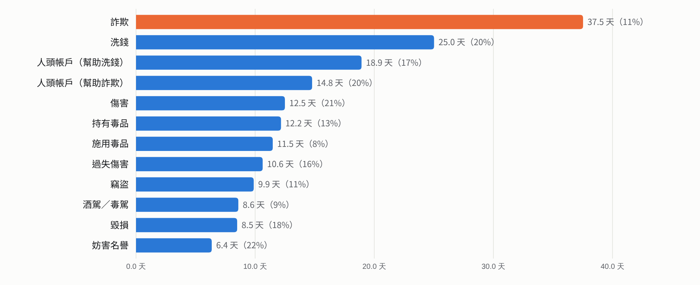
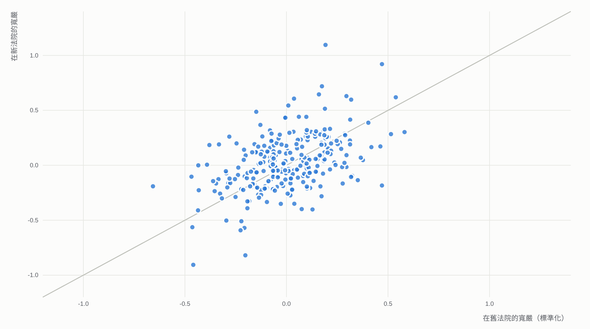
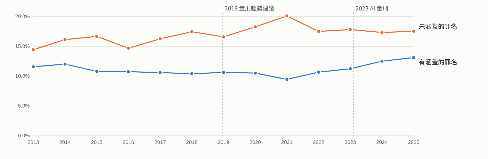
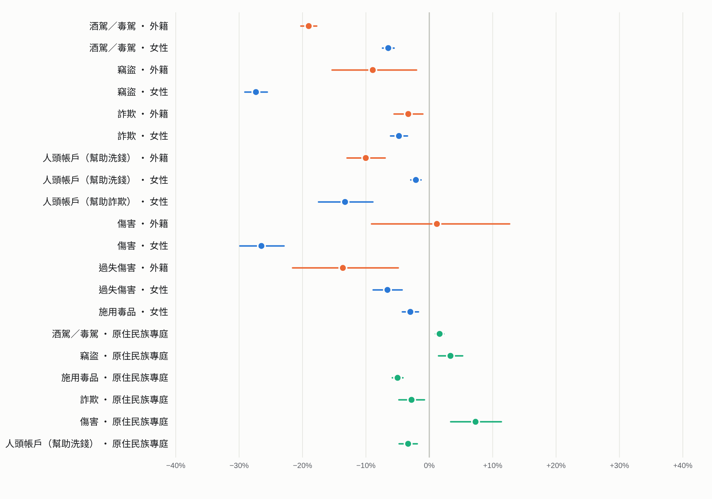
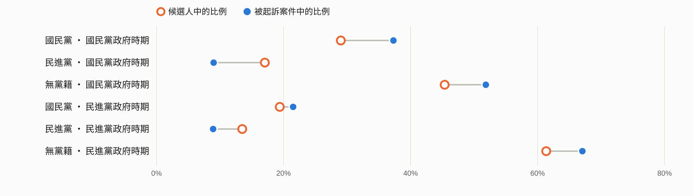

[English full report](README.md) · **繁體中文白話版**

# 同一件案子，換一位法官，結果會一樣嗎？

法律說，相同的案子應該得到相同的處理。我們用司法院公開的資料，看了 2013 到 2026 年全國地方法院 1,560,890 件由一位法官獨任審理的刑事案件，加上 2,283 件選舉犯罪判決，想知道判決結果有多少是取決於「抽到哪位法官」、「被告是誰」，以及政治。

資料來源：司法院資料開放平臺（終結案件資料、裁判書）、中選會候選人資料 
這是給一般讀者的簡明版；完整英文版含所有圖表、方法與具名法官表 

## 先講結論

| 數字 | 意思 |
|---|---|
| <b>38 天</b> | 詐欺案隨機抽兩位同法院法官，對類似案件的刑期平均相差的天數（平均刑期約 333 天） |
| <b>40%</b> | 詐欺案「要不要併科罰金」的差異中，可歸因於法官本人的比例 |
| <b>77%–99%</b> | 法官之間的刑期差距，經過上訴後仍然留下來的比例 |
| <b>0.53</b> | 法官調到別的法院後，寬嚴程度與原本的相關係數：風格跟著人走 |

1. <b>有罪無罪幾乎不看法官，判多重很看法官。</b>這類案件幾乎都判有罪，不同法官的定罪率最多只差約 2.2 個百分點。但刑期長短、給不給緩刑、要不要另外併科罰金，同一法院的法官之間有穩定、明顯的差別。
2. <b>這不是運氣，是法官個人的風格。</b>把一位法官的案件隨機分成兩半，兩半的寬嚴程度高度一致；這種風格持續多年，法官調到別的法院也大致不變。
3. <b>量刑輔助工具沒有讓差距變小。</b>2018 年的量刑趨勢建議系統之後，看不出可靠的改善；2023 年 AI 量刑資訊系統上線後，法官之間的差距反而相對變大（同時期酒駕、詐欺的刑罰也加重了，所以不能直接怪系統）。
4. <b>上訴也修正不了多少。</b>只有約 5.9% 的案件被上訴，二審之後大部分的法官差距仍然存在。
5. <b>不是新手法官的問題。</b>剛上任三年內的法官，和資深法官判得差不多。
6. <b>被告是誰，有些影響。</b>外籍被告的酒駕刑期，即使考慮酒測值和前科，仍比類似的本國被告短約 11%；女性被告在竊盜、傷害案的刑期明顯較短。
7. <b>羈押中能不能交保，也看法官。</b>同一法院同一年，不同法官准許具保停止羈押的機率，差距可達十幾個百分點。
8. <b>政治：沒有看到檢方特別追殺在野黨，但有一個值得注意的落差。</b>國民黨或民進黨相關被告的定罪率沒有可偵測的差別；2016 年政黨輪替後，國民黨相關案件的比例也沒有增加。不過，與「當時在野黨」相關的被告，獲得緩刑的機率低約 12 個百分點。

## 為什麼可以拿法官來比較？

地方法院的案件是依照事先訂好的規則輪分或抽籤（分案），不是法官自己挑，也不是被告能選。所以在<b>同一法院、同一種案件、同一季</b>裡，抽到 A 法官的被告和抽到 B 法官的被告，整體來說是差不多的一群人。如果兩位法官的判決長期系統性不同，差別就來自法官本人。

我們還扣掉了資料裡記載的案情因素，例如累犯、未遂、共犯、自白、自首、刑法第 59 條酌減、有沒有律師、觸犯的具體條文。我們也用統計方法排除「案件少的法官看起來比較極端」這種純屬運氣的影響。

> 打個比方：同一間學校的老師隨機分到差不多的學生，如果某位老師給分一直比別人高，那就是老師的給分習慣，而不是學生比較厲害。

## 換一位法官，刑期差多少？

下圖是：在同一法院隨機抽兩位法官，處理類似案件時，刑期平均會差幾天。以酒駕為例，平均刑期約 101 天，兩位法官平均差 8.6 天；詐欺平均刑期約 333 天，差 38 天。換算下來，差距大約是一般刑期的 8% 到 21%。

<b>隨機抽兩位同法院法官，類似案件的刑期平均差幾天</b>

<picture>
  <source media="(prefers-color-scheme: dark)" srcset="figures/zh/z-gap-dark.png">
  
</picture>

2013–2026 年，已扣除案情因素與法院、時期的差異。括號內是差距佔該罪名平均刑期的百分比。

<b>緩刑和罰金更看法官。</b>酒駕案要不要給緩刑，有 12% 的差異可歸因於法官；要不要在徒刑之外再併科罰金，更高達 26%（罰金資料 2024 年起才有記載）。詐欺案很少併科罰金（約 4.6%），但這件事幾乎完全看法官：大部分法官幾乎不用，少數法官則常常使用。

<b>具名法官表。</b>判決書依法公開並載明法官姓名，所以完整英文版列出了 2022 年以來案件數達 100 件以上的法官，和同法院其他法官相比的結果，並附上信賴區間與排名範圍。例如酒駕案共 442 位法官符合條件，其中 41 位明顯較重、41 位明顯較輕。這些判決都在法定刑度內，差別不代表違法或失職，只反映「誰來判」對結果的影響。

下面依罪名和判決項目分組，只列出「明顯較高」或「明顯較低」的法官，點一下標題就能展開。「較高」是指該項結果比較多：刑期較長、較常給緩刑，或較常併科罰金。數字是和同一法院其他法官處理類似案件相比的差距，附 95% 信賴區間；排名是這位法官在同院列入比較的法官中的百分位（90% 範圍，數字越大越高）。全部 1,946 筆估計（包括沒有被標記的法官）在 [`data/named_judges.csv`](data/named_judges.csv)，GitHub 會把它顯示成可以搜尋的表格。

<b>酒駕／毒駕・刑期</b>：442 位法官中，41 位明顯較高、41 位明顯較低

| 法院 | 法官 | 件數 | 與同院平均相比（天） | 95% 信賴區間 | 院內排名（90% 範圍） | 標記 |
|---|---|---|---|---|---|---|
| 桃園 | 蔡旻穎 | 286 | +44.3 | +40.4 至 +48.1 | 第 99 百分位（共 80 位） | 明顯較高 |
| 新竹 | 王怡蓁 | 144 | +35.8 | +30.5 至 +41.0 | 第 98 百分位（共 21 位） | 明顯較高 |
| 臺中 | 陳培維 | 156 | +30.7 | +25.7 至 +35.8 | 第 99 百分位（共 61 位） | 明顯較高 |
| 桃園 | 葉宇修 | 130 | +28.0 | +22.5 至 +33.5 | 第 94–98 百分位（共 80 位） | 明顯較高 |
| 桃園 | 高世軒 | 122 | +26.0 | +20.3 至 +31.7 | 第 93–98 百分位（共 80 位） | 明顯較高 |
| 桃園 | 方楷烽 | 181 | +25.7 | +21.0 至 +30.4 | 第 93–98 百分位（共 80 位） | 明顯較高 |
| 臺南 | 莊政達 | 120 | +23.6 | +17.8 至 +29.3 | 第 94–99 百分位（共 56 位） | 明顯較高 |
| 桃園 | 郭鍵融 | 120 | +23.0 | +17.3 至 +28.7 | 第 92–97 百分位（共 80 位） | 明顯較高 |
| 臺南 | 周紹武 | 266 | +22.6 | +18.6 至 +26.6 | 第 94–99 百分位（共 56 位） | 明顯較高 |
| 彰化 | 王祥豪 | 335 | +22.2 | +18.7 至 +25.8 | 第 99 百分位（共 35 位） | 明顯較高 |
| 臺南 | 林欣玲 | 312 | +21.9 | +18.2 至 +25.5 | 第 92–99 百分位（共 56 位） | 明顯較高 |
| 桃園 | 陳藝文 | 134 | +21.3 | +15.8 至 +26.7 | 第 92–96 百分位（共 80 位） | 明顯較高 |
| 臺南 | 林政斌 | 169 | +19.9 | +15.0 至 +24.8 | 第 88–99 百分位（共 56 位） | 明顯較高 |
| 桃園 | 黃弘宇 | 188 | +18.5 | +13.9 至 +23.2 | 第 91–94 百分位（共 80 位） | 明顯較高 |
| 基隆 | 李岳 | 135 | +18.3 | +12.9 至 +23.7 | 第 90 百分位（共 5 位） | 明顯較高 |
| 苗栗 | 顏碩瑋 | 205 | +18.0 | +13.5 至 +22.5 | 第 97 百分位（共 15 位） | 明顯較高 |
| 臺中 | 徐煥淵 | 164 | +17.8 | +12.8 至 +22.7 | 第 93–98 百分位（共 61 位） | 明顯較高 |
| 臺南 | 鄧希賢 | 279 | +17.5 | +13.6 至 +21.4 | 第 87–94 百分位（共 56 位） | 明顯較高 |
| 新北 | 楊肅宇 | 314 | +17.4 | +13.8 至 +21.1 | 第 92–97 百分位（共 19 位） | 明顯較高 |
| 新竹 | 翁禎翊 | 128 | +17.4 | +11.9 至 +23.0 | 第 88–93 百分位（共 21 位） | 明顯較高 |
| 臺南 | 陳碧玉 | 259 | +17.4 | +13.4 至 +21.4 | 第 87–96 百分位（共 56 位） | 明顯較高 |
| 嘉義 | 陳威憲 | 161 | +17.3 | +12.3 至 +22.3 | 第 83–98 百分位（共 26 位） | 明顯較高 |
| 嘉義 | 何啓榮 | 127 | +16.9 | +11.3 至 +22.5 | 第 83–98 百分位（共 26 位） | 明顯較高 |
| 臺中 | 湯有朋 | 148 | +16.4 | +11.2 至 +21.6 | 第 91–98 百分位（共 61 位） | 明顯較高 |
| 臺南 | 蔡奇秀 | 201 | +16.0 | +11.5 至 +20.5 | 第 83–94 百分位（共 56 位） | 明顯較高 |
| 新竹 | 江永楨 | 133 | +15.6 | +10.1 至 +21.0 | 第 83–93 百分位（共 21 位） | 明顯較高 |
| 士林 | 黃雅君 | 488 | +15.2 | +12.2 至 +18.1 | 第 95 百分位（共 10 位） | 明顯較高 |
| 花蓮 | 王龍寬 | 120 | +15.0 | +9.3 至 +20.7 | 第 96 百分位（共 14 位） | 明顯較高 |
| 臺中 | 陳建宇 | 122 | +14.0 | +8.3 至 +19.7 | 第 84–98 百分位（共 61 位） | 明顯較高 |
| 彰化 | 巫美蕙 | 311 | +13.2 | +9.5 至 +16.8 | 第 90–96 百分位（共 35 位） | 明顯較高 |
| 桃園 | 黃筱晴 | 240 | +13.1 | +8.9 至 +17.2 | 第 84–91 百分位（共 80 位） | 明顯較高 |
| 臺中 | 王曼寧 | 135 | +13.0 | +7.5 至 +18.4 | 第 83–96 百分位（共 61 位） | 明顯較高 |
| 雲林 | 梁智賢 | 125 | +12.9 | +7.3 至 +18.6 | 第 85–97 百分位（共 17 位） | 明顯較高 |
| 彰化 | 許淞傑 | 187 | +12.0 | +7.3 至 +16.7 | 第 90–96 百分位（共 35 位） | 明顯較高 |
| 臺中 | 吳欣哲 | 171 | +11.8 | +6.9 至 +16.6 | 第 81–96 百分位（共 61 位） | 明顯較高 |
| 桃園 | 鄧瑋琪 | 225 | +11.7 | +7.4 至 +16.0 | 第 81–91 百分位（共 80 位） | 明顯較高 |
| 臺中 | 呂超群 | 129 | +11.7 | +6.2 至 +17.2 | 第 81–96 百分位（共 61 位） | 明顯較高 |
| 臺中 | 陳嘉宏 | 210 | +10.8 | +6.4 至 +15.2 | 第 81–94 百分位（共 61 位） | 明顯較高 |
| 彰化 | 吳永梁 | 105 | +10.3 | +4.2 至 +16.4 | 第 84–96 百分位（共 35 位） | 明顯較高 |
| 宜蘭 | 蕭淳元 | 103 | +10.2 | +4.1 至 +16.4 | 第 82–96 百分位（共 14 位） | 明顯較高 |
| 高雄 | 李承曄 | 1,066 | +6.0 | +4.0 至 +8.0 | 第 88–98 百分位（共 20 位） | 明顯較高 |
| 嘉義 | 王品惠 | 189 | −21.1 | −25.7 至 −16.4 | 第 2–6 百分位（共 26 位） | 明顯較低 |
| 桃園 | 呂秉炎 | 121 | −20.8 | −26.5 至 −15.1 | 第 1–4 百分位（共 80 位） | 明顯較低 |
| 臺南 | 黃毓庭 | 126 | −20.4 | −26.0 至 −14.8 | 第 1–6 百分位（共 56 位） | 明顯較低 |
| 新竹 | 黃美盈 | 101 | −19.0 | −25.2 至 −12.8 | 第 2–7 百分位（共 21 位） | 明顯較低 |
| 新北 | 劉安榕 | 128 | −18.8 | −24.4 至 −13.3 | 第 3–8 百分位（共 19 位） | 明顯較低 |
| 新北 | 潘長生 | 1,182 | −18.7 | −20.6 至 −16.8 | 第 3–8 百分位（共 19 位） | 明顯較低 |
| 臺南 | 卓穎毓 | 189 | −18.4 | −23.0 至 −13.7 | 第 1–8 百分位（共 56 位） | 明顯較低 |
| 臺中 | 李昇蓉 | 105 | −18.2 | −24.3 至 −12.1 | 第 1–9 百分位（共 61 位） | 明顯較低 |
| 桃園 | 張英尉 | 221 | −17.5 | −21.8 至 −13.1 | 第 1–7 百分位（共 80 位） | 明顯較低 |
| 苗栗 | 紀雅惠 | 265 | −17.1 | −21.0 至 −13.1 | 第 3–10 百分位（共 15 位） | 明顯較低 |
| 桃園 | 曾煒庭 | 173 | −16.9 | −21.7 至 −12.0 | 第 1–8 百分位（共 80 位） | 明顯較低 |
| 桃園 | 何信儀 | 138 | −16.7 | −22.1 至 −11.4 | 第 1–8 百分位（共 80 位） | 明顯較低 |
| 臺中 | 張美眉 | 134 | −16.3 | −21.8 至 −10.9 | 第 1–12 百分位（共 61 位） | 明顯較低 |
| 新竹 | 蔡玉琪 | 204 | −16.1 | −20.5 至 −11.6 | 第 2–12 百分位（共 21 位） | 明顯較低 |
| 臺中 | 彭國能 | 148 | −15.7 | −20.9 至 −10.5 | 第 1–12 百分位（共 61 位） | 明顯較低 |
| 臺南 | 周宛瑩 | 319 | −15.5 | −19.1 至 −11.9 | 第 3–13 百分位（共 56 位） | 明顯較低 |
| 嘉義 | 卓春慧 | 241 | −15.3 | −19.4 至 −11.1 | 第 6–17 百分位（共 26 位） | 明顯較低 |
| 臺南 | 蕭雅毓 | 226 | −15.2 | −19.5 至 −10.9 | 第 3–13 百分位（共 56 位） | 明顯較低 |
| 臺中 | 黃佳琪 | 140 | −15.1 | −20.5 至 −9.8 | 第 1–14 百分位（共 61 位） | 明顯較低 |
| 臺中 | 吳逸儒 | 130 | −15.1 | −20.6 至 −9.6 | 第 1–14 百分位（共 61 位） | 明顯較低 |
| 桃園 | 羅杰治 | 192 | −15.0 | −19.6 至 −10.3 | 第 2–12 百分位（共 80 位） | 明顯較低 |
| 臺南 | 鄭燕璘 | 245 | −14.9 | −19.0 至 −10.8 | 第 3–15 百分位（共 56 位） | 明顯較低 |
| 嘉義 | 郭振杰 | 190 | −14.8 | −19.5 至 −10.2 | 第 6–17 百分位（共 26 位） | 明顯較低 |
| 臺中 | 丁智慧 | 126 | −14.8 | −20.4 至 −9.2 | 第 1–14 百分位（共 61 位） | 明顯較低 |
| 臺中 | 戰諭威 | 142 | −14.6 | −19.9 至 −9.3 | 第 2–16 百分位（共 61 位） | 明顯較低 |
| 臺南 | 高如宜 | 275 | −13.9 | −17.8 至 −10.0 | 第 4–17 百分位（共 56 位） | 明顯較低 |
| 臺東 | 姚亞儒 | 305 | −13.8 | −17.6 至 −10.2 | 第 5–15 百分位（共 10 位） | 明顯較低 |
| 臺南 | 王惠芬 | 264 | −13.6 | −17.6 至 −9.7 | 第 4–17 百分位（共 56 位） | 明顯較低 |
| 嘉義 | 粘柏富 | 105 | −13.5 | −19.6 至 −7.4 | 第 6–17 百分位（共 26 位） | 明顯較低 |
| 士林 | 張明儀 | 825 | −13.2 | −15.5 至 −10.9 | 第 5 百分位（共 10 位） | 明顯較低 |
| 嘉義 | 官怡臻 | 167 | −13.1 | −18.1 至 −8.2 | 第 6–17 百分位（共 26 位） | 明顯較低 |
| 雲林 | 楊謹瑜 | 143 | −13.1 | −18.4 至 −7.8 | 第 3–15 百分位（共 17 位） | 明顯較低 |
| 桃園 | 孫立婷 | 192 | −12.4 | −17.0 至 −7.8 | 第 4–19 百分位（共 80 位） | 明顯較低 |
| 雲林 | 蔡宗儒 | 104 | −12.2 | −18.4 至 −6.2 | 第 3–15 百分位（共 17 位） | 明顯較低 |
| 彰化 | 高郁茹 | 192 | −10.8 | −15.4 至 −6.1 | 第 1–13 百分位（共 35 位） | 明顯較低 |
| 臺東 | 林涵雯 | 196 | −10.2 | −14.8 至 −5.6 | 第 5–15 百分位（共 10 位） | 明顯較低 |
| 宜蘭 | 陳嘉瑜 | 314 | −9.7 | −13.4 至 −6.1 | 第 4–18 百分位（共 14 位） | 明顯較低 |
| 彰化 | 李淑惠 | 295 | −9.3 | −13.1 至 −5.6 | 第 1–16 百分位（共 35 位） | 明顯較低 |
| 高雄 | 張震 | 715 | −8.1 | −10.5 至 −5.6 | 第 2–12 百分位（共 20 位） | 明顯較低 |
| 高雄 | 林英奇 | 426 | −8.0 | −11.1 至 −4.8 | 第 2–18 百分位（共 20 位） | 明顯較低 |
| 橋頭 | 洪柏鑫 | 519 | −7.0 | −9.9 至 −4.2 | 第 3–10 百分位（共 15 位） | 明顯較低 |

<b>酒駕／毒駕・緩刑率</b>：442 位法官中，52 位明顯較高、4 位明顯較低

| 法院 | 法官 | 件數 | 與同院平均相比（百分點） | 95% 信賴區間 | 院內排名（90% 範圍） | 標記 |
|---|---|---|---|---|---|---|
| 新竹 | 馮俊郎 | 105 | +46.2 | +43.3 至 +49.2 | 第 98 百分位（共 21 位） | 明顯較高 |
| 桃園 | 羅杰治 | 192 | +31.7 | +29.5 至 +33.9 | 第 98–99 百分位（共 80 位） | 明顯較高 |
| 桃園 | 劉得為 | 128 | +29.1 | +26.4 至 +31.8 | 第 96–99 百分位（共 80 位） | 明顯較高 |
| 桃園 | 林育駿 | 251 | +29.0 | +27.1 至 +30.9 | 第 96–98 百分位（共 80 位） | 明顯較高 |
| 基隆 | 施添寶 | 105 | +28.4 | +25.5 至 +31.4 | 第 90 百分位（共 5 位） | 明顯較高 |
| 嘉義 | 粘柏富 | 105 | +28.1 | +25.2 至 +31.1 | 第 98 百分位（共 26 位） | 明顯較高 |
| 桃園 | 曾煒庭 | 173 | +27.5 | +25.2 至 +29.8 | 第 94–98 百分位（共 80 位） | 明顯較高 |
| 桃園 | 莊劍郎 | 108 | +26.5 | +23.6 至 +29.4 | 第 94–97 百分位（共 80 位） | 明顯較高 |
| 臺北 | 姚念慈 | 106 | +25.4 | +22.4 至 +28.3 | 第 96 百分位（共 11 位） | 明顯較高 |
| 彰化 | 李怡昕 | 237 | +23.3 | +21.3 至 +25.3 | 第 99 百分位（共 35 位） | 明顯較高 |
| 高雄 | 李承曄 | 1,066 | +22.2 | +21.3 至 +23.2 | 第 98 百分位（共 20 位） | 明顯較高 |
| 臺南 | 鄭文祺 | 129 | +21.6 | +18.9 至 +24.2 | 第 99 百分位（共 56 位） | 明顯較高 |
| 橋頭 | 陳明呈 | 247 | +20.9 | +18.9 至 +22.8 | 第 97 百分位（共 15 位） | 明顯較高 |
| 桃園 | 謝長志 | 171 | +20.2 | +17.9 至 +22.6 | 第 89–93 百分位（共 80 位） | 明顯較高 |
| 桃園 | 陳藝文 | 134 | +19.8 | +17.2 至 +22.4 | 第 89–93 百分位（共 80 位） | 明顯較高 |
| 新北 | 張誌洋 | 112 | +19.1 | +16.2 至 +21.9 | 第 92–97 百分位（共 19 位） | 明顯較高 |
| 桃園 | 何宇宸 | 277 | +18.7 | +16.8 至 +20.5 | 第 88–93 百分位（共 80 位） | 明顯較高 |
| 桃園 | 古御詩 | 163 | +18.6 | +16.2 至 +21.0 | 第 88–93 百分位（共 80 位） | 明顯較高 |
| 彰化 | 陳怡潔 | 312 | +18.4 | +16.6 至 +20.1 | 第 96 百分位（共 35 位） | 明顯較高 |
| 新北 | 俞兆安 | 220 | +17.5 | +15.4 至 +19.6 | 第 92–97 百分位（共 19 位） | 明顯較高 |
| 桃園 | 林述亨 | 463 | +17.2 | +15.8 至 +18.7 | 第 88–91 百分位（共 80 位） | 明顯較高 |
| 花蓮 | 劉孟昕 | 181 | +15.4 | +13.1 至 +17.7 | 第 82–96 百分位（共 14 位） | 明顯較高 |
| 花蓮 | 鍾晴 | 105 | +14.7 | +11.8 至 +17.6 | 第 82–96 百分位（共 14 位） | 明顯較高 |
| 宜蘭 | 游欣怡 | 133 | +14.4 | +11.8 至 +17.1 | 第 96 百分位（共 14 位） | 明顯較高 |
| 桃園 | 施育傑 | 106 | +13.4 | +10.4 至 +16.3 | 第 84–87 百分位（共 80 位） | 明顯較高 |
| 花蓮 | 黃夢萱 | 100 | +13.2 | +10.2 至 +16.2 | 第 82–96 百分位（共 14 位） | 明顯較高 |
| 臺南 | 黃毓庭 | 126 | +11.9 | +9.2 至 +14.6 | 第 94–97 百分位（共 56 位） | 明顯較高 |
| 桃園 | 郭鍵融 | 120 | +11.8 | +9.0 至 +14.5 | 第 83–87 百分位（共 80 位） | 明顯較高 |
| 士林 | 許凱翔 | 100 | +11.8 | +8.8 至 +14.8 | 第 95 百分位（共 10 位） | 明顯較高 |
| 彰化 | 余仕明 | 115 | +11.7 | +8.8 至 +14.5 | 第 93 百分位（共 35 位） | 明顯較高 |
| 桃園 | 潘曉萱 | 277 | +10.6 | +8.7 至 +12.4 | 第 83–86 百分位（共 80 位） | 明顯較高 |
| 臺南 | 廖建瑋 | 204 | +10.5 | +8.3 至 +12.6 | 第 92–97 百分位（共 56 位） | 明顯較高 |
| 桃園 | 陳韋如 | 268 | +10.3 | +8.5 至 +12.2 | 第 83–86 百分位（共 80 位） | 明顯較高 |
| 宜蘭 | 劉致欽 | 156 | +9.9 | +7.5 至 +12.3 | 第 89 百分位（共 14 位） | 明顯較高 |
| 臺南 | 潘明彥 | 380 | +9.9 | +8.3 至 +11.4 | 第 92–96 百分位（共 56 位） | 明顯較高 |
| 臺南 | 王惠芬 | 264 | +8.9 | +7.0 至 +10.8 | 第 92–96 百分位（共 56 位） | 明顯較高 |
| 臺中 | 鄭咏欣 | 152 | +8.1 | +5.6 至 +10.5 | 第 99 百分位（共 61 位） | 明顯較高 |
| 新竹 | 李建慶 | 194 | +7.9 | +5.7 至 +10.1 | 第 83–93 百分位（共 21 位） | 明顯較高 |
| 橋頭 | 李冠儀 | 689 | +7.8 | +6.7 至 +9.0 | 第 90 百分位（共 15 位） | 明顯較高 |
| 桃園 | 方楷烽 | 181 | +7.8 | +5.5 至 +10.0 | 第 82–83 百分位（共 80 位） | 明顯較高 |
| 苗栗 | 高御庭 | 110 | +7.6 | +4.7 至 +10.4 | 第 97 百分位（共 15 位） | 明顯較高 |
| 彰化 | 宋庭華 | 189 | +7.4 | +5.2 至 +9.6 | 第 84–90 百分位（共 35 位） | 明顯較高 |
| 新竹 | 楊祐庭 | 147 | +7.1 | +4.6 至 +9.6 | 第 83–93 百分位（共 21 位） | 明顯較高 |
| 新北 | 何奕萱 | 387 | +7.1 | +5.5 至 +8.6 | 第 87 百分位（共 19 位） | 明顯較高 |
| 士林 | 葛名翔 | 664 | +7.0 | +5.8 至 +8.2 | 第 85 百分位（共 10 位） | 明顯較高 |
| 彰化 | 梁義順 | 111 | +5.9 | +3.0 至 +8.8 | 第 81–90 百分位（共 35 位） | 明顯較高 |
| 彰化 | 黃佩穎 | 125 | +5.6 | +2.9 至 +8.3 | 第 81–90 百分位（共 35 位） | 明顯較高 |
| 臺東 | 姚亞儒 | 305 | +5.5 | +3.7 至 +7.2 | 第 95 百分位（共 10 位） | 明顯較高 |
| 臺中 | 黃建都 | 143 | +4.7 | +2.1 至 +7.2 | 第 94–98 百分位（共 61 位） | 明顯較高 |
| 臺中 | 黃凡瑄 | 112 | +3.9 | +1.1 至 +6.8 | 第 89–98 百分位（共 61 位） | 明顯較高 |
| 臺南 | 茆怡文 | 179 | +3.6 | +1.3 至 +5.9 | 第 85–90 百分位（共 56 位） | 明顯較高 |
| 臺南 | 周宛瑩 | 319 | +2.9 | +1.1 至 +4.6 | 第 83–90 百分位（共 56 位） | 明顯較高 |
| 橋頭 | 許博鈞 | 665 | −9.1 | −10.2 至 −7.8 | 第 3 百分位（共 15 位） | 明顯較低 |
| 高雄 | 賴建旭 | 967 | −5.5 | −6.5 至 −4.5 | 第 2–18 百分位（共 20 位） | 明顯較低 |
| 橋頭 | 林永村 | 422 | −5.1 | −6.6 至 −3.6 | 第 10 百分位（共 15 位） | 明顯較低 |
| 士林 | 林銘宏 | 180 | −4.8 | −7.1 至 −2.6 | 第 5–6 百分位（共 10 位） | 明顯較低 |

<b>酒駕／毒駕・併科罰金率（2024–2026 年）</b>：219 位法官中，30 位明顯較高、11 位明顯較低

| 法院 | 法官 | 件數 | 與同院平均相比（百分點） | 95% 信賴區間 | 院內排名（90% 範圍） | 標記 |
|---|---|---|---|---|---|---|
| 新北 | 黎錦福 | 544 | +63.0 | +60.0 至 +66.0 | 第 97 百分位（共 15 位） | 明顯較高 |
| 桃園 | 吳宜珍 | 111 | +60.8 | +54.3 至 +67.4 | 第 92–99 百分位（共 43 位） | 明顯較高 |
| 桃園 | 林其玄 | 160 | +60.7 | +55.2 至 +66.2 | 第 92–99 百分位（共 43 位） | 明顯較高 |
| 桃園 | 李信龍 | 143 | +56.5 | +50.7 至 +62.3 | 第 90–99 百分位（共 43 位） | 明顯較高 |
| 桃園 | 蔡旻穎 | 132 | +56.5 | +50.5 至 +62.5 | 第 90–99 百分位（共 43 位） | 明顯較高 |
| 臺南 | 盧鳳田 | 189 | +52.5 | +47.4 至 +57.5 | 第 99 百分位（共 38 位） | 明顯較高 |
| 桃園 | 黃筱晴 | 154 | +49.7 | +44.1 至 +55.2 | 第 87–92 百分位（共 43 位） | 明顯較高 |
| 新北 | 吳丁偉 | 236 | +48.8 | +44.2 至 +53.3 | 第 90 百分位（共 15 位） | 明顯較高 |
| 桃園 | 何信儀 | 138 | +48.5 | +42.6 至 +54.4 | 第 87–90 百分位（共 43 位） | 明顯較高 |
| 士林 | 楊峻宇 | 590 | +45.8 | +42.9 至 +48.7 | 第 90 百分位（共 5 位） | 明顯較高 |
| 新竹 | 王怡蓁 | 116 | +45.2 | +38.8 至 +51.6 | 第 95 百分位（共 10 位） | 明顯較高 |
| 臺南 | 陳本良 | 103 | +42.0 | +35.1 至 +48.8 | 第 96 百分位（共 38 位） | 明顯較高 |
| 桃園 | 范振義 | 124 | +39.7 | +33.5 至 +46.0 | 第 85 百分位（共 43 位） | 明顯較高 |
| 新北 | 俞兆安 | 220 | +38.5 | +33.8 至 +43.2 | 第 83 百分位（共 15 位） | 明顯較高 |
| 高雄 | 賴建旭 | 506 | +37.3 | +34.2 至 +40.4 | 第 96 百分位（共 13 位） | 明顯較高 |
| 臺東 | 陳偉達 | 230 | +31.5 | +26.9 至 +36.0 | 第 94 百分位（共 9 位） | 明顯較高 |
| 苗栗 | 顏碩瑋 | 131 | +31.3 | +25.2 至 +37.3 | 第 95 百分位（共 10 位） | 明顯較高 |
| 彰化 | 許家偉 | 166 | +30.8 | +25.4 至 +36.2 | 第 94–98 百分位（共 23 位） | 明顯較高 |
| 臺南 | 潘明彥 | 210 | +30.8 | +25.9 至 +35.6 | 第 91–93 百分位（共 38 位） | 明顯較高 |
| 臺南 | 周紹武 | 186 | +30.5 | +25.4 至 +35.6 | 第 91–93 百分位（共 38 位） | 明顯較高 |
| 桃園 | 邱筠雅 | 127 | +29.1 | +23.0 至 +35.3 | 第 80–83 百分位（共 43 位） | 明顯較高 |
| 彰化 | 張琇涵 | 168 | +27.5 | +22.1 至 +32.9 | 第 89–98 百分位（共 23 位） | 明顯較高 |
| 宜蘭 | 程明慧 | 144 | +27.0 | +21.2 至 +32.8 | 第 96 百分位（共 11 位） | 明顯較高 |
| 花蓮 | 劉孟昕 | 121 | +23.9 | +17.6 至 +30.2 | 第 90 百分位（共 5 位） | 明顯較高 |
| 彰化 | 熊霈淳 | 152 | +21.4 | +15.8 至 +27.0 | 第 80–94 百分位（共 23 位） | 明顯較高 |
| 彰化 | 林慧欣 | 170 | +20.5 | +15.2 至 +25.8 | 第 80–89 百分位（共 23 位） | 明顯較高 |
| 彰化 | 簡仲頤 | 174 | +18.5 | +13.2 至 +23.8 | 第 80–89 百分位（共 23 位） | 明顯較高 |
| 新竹 | 江宜穎 | 104 | +16.9 | +10.1 至 +23.7 | 第 85 百分位（共 10 位） | 明顯較高 |
| 臺東 | 陳昱維 | 228 | +16.7 | +12.1 至 +21.3 | 第 83 百分位（共 9 位） | 明顯較高 |
| 屏東 | 楊青豫 | 463 | +15.6 | +12.3 至 +18.8 | 第 90 百分位（共 5 位） | 明顯較高 |
| 高雄 | 李承曄 | 607 | −53.5 | −56.4 至 −50.7 | 第 4 百分位（共 13 位） | 明顯較低 |
| 臺中 | 黃渙文 | 125 | −41.5 | −47.7 至 −35.3 | 第 5 百分位（共 10 位） | 明顯較低 |
| 桃園 | 高世軒 | 122 | −34.0 | −40.3 至 −27.7 | 第 1–13 百分位（共 43 位） | 明顯較低 |
| 桃園 | 張明宏 | 166 | −32.8 | −38.2 至 −27.4 | 第 1–15 百分位（共 43 位） | 明顯較低 |
| 高雄 | 林軒鋒 | 598 | −32.5 | −35.4 至 −29.7 | 第 12 百分位（共 13 位） | 明顯較低 |
| 臺南 | 鄭雅文 | 341 | −25.7 | −29.5 至 −21.9 | 第 1–12 百分位（共 38 位） | 明顯較低 |
| 高雄 | 呂明燕 | 112 | −24.8 | −31.3 至 −18.2 | 第 19 百分位（共 13 位） | 明顯較低 |
| 新北 | 楊肅宇 | 314 | −24.2 | −28.1 至 −20.2 | 第 3–10 百分位（共 15 位） | 明顯較低 |
| 臺南 | 林岳葳 | 274 | −23.1 | −27.3 至 −18.9 | 第 1–20 百分位（共 38 位） | 明顯較低 |
| 新北 | 徐子涵 | 906 | −23.1 | −25.4 至 −20.7 | 第 3–10 百分位（共 15 位） | 明顯較低 |
| 屏東 | 黃紀錄 | 931 | −8.4 | −10.7 至 −6.1 | 第 10 百分位（共 5 位） | 明顯較低 |

<b>竊盜・刑期</b>：216 位法官中，19 位明顯較高、12 位明顯較低

| 法院 | 法官 | 件數 | 與同院平均相比（天） | 95% 信賴區間 | 院內排名（90% 範圍） | 標記 |
|---|---|---|---|---|---|---|
| 臺北 | 宋恩同 | 156 | +34.2 | +28.1 至 +40.4 | 第 97 百分位（共 16 位） | 明顯較高 |
| 基隆 | 李岳 | 143 | +33.2 | +26.8 至 +39.6 | 第 92 百分位（共 6 位） | 明顯較高 |
| 臺南 | 張婉寧 | 106 | +28.2 | +20.9 至 +35.5 | 第 98 百分位（共 23 位） | 明顯較高 |
| 彰化 | 王祥豪 | 162 | +26.4 | +20.4 至 +32.5 | 第 92–97 百分位（共 19 位） | 明顯較高 |
| 臺北 | 賴鵬年 | 189 | +22.1 | +16.5 至 +27.8 | 第 91 百分位（共 16 位） | 明顯較高 |
| 彰化 | 林怡君 | 130 | +21.3 | +14.6 至 +27.9 | 第 87–97 百分位（共 19 位） | 明顯較高 |
| 苗栗 | 朱俊瑋 | 220 | +20.8 | +15.5 至 +26.0 | 第 88–96 百分位（共 12 位） | 明顯較高 |
| 新竹 | 王怡蓁 | 105 | +20.1 | +12.7 至 +27.4 | 第 94 百分位（共 9 位） | 明顯較高 |
| 臺中 | 陳盈睿 | 141 | +18.1 | +11.7 至 +24.6 | 第 88–96 百分位（共 13 位） | 明顯較高 |
| 苗栗 | 顏碩瑋 | 144 | +17.2 | +10.8 至 +23.6 | 第 88–96 百分位（共 12 位） | 明顯較高 |
| 臺中 | 王曼寧 | 109 | +16.9 | +9.7 至 +24.1 | 第 88–96 百分位（共 13 位） | 明顯較高 |
| 桃園 | 陳布衣 | 169 | +16.8 | +10.8 至 +22.7 | 第 89–98 百分位（共 32 位） | 明顯較高 |
| 士林 | 黃雅君 | 100 | +15.8 | +8.3 至 +23.2 | 第 95 百分位（共 10 位） | 明顯較高 |
| 彰化 | 陳建文 | 121 | +14.8 | +7.9 至 +21.6 | 第 82–92 百分位（共 19 位） | 明顯較高 |
| 桃園 | 蔡旻穎 | 155 | +14.5 | +8.3 至 +20.7 | 第 86–98 百分位（共 32 位） | 明顯較高 |
| 桃園 | 黃弘宇 | 104 | +14.3 | +7.0 至 +21.6 | 第 83–98 百分位（共 32 位） | 明顯較高 |
| 高雄 | 張震 | 483 | +12.8 | +9.2 至 +16.4 | 第 92–98 百分位（共 20 位） | 明顯較高 |
| 桃園 | 曾雨明 | 319 | +12.7 | +8.3 至 +17.1 | 第 83–95 百分位（共 32 位） | 明顯較高 |
| 新北 | 徐蘭萍 | 677 | +9.7 | +6.6 至 +12.7 | 第 84–98 百分位（共 22 位） | 明顯較高 |
| 臺北 | 翁毓潔 | 134 | −20.9 | −27.5 至 −14.4 | 第 3–9 百分位（共 16 位） | 明顯較低 |
| 臺南 | 鄭銘仁 | 139 | −20.6 | −27.1 至 −14.2 | 第 2–6 百分位（共 23 位） | 明顯較低 |
| 苗栗 | 洪振峰 | 141 | −19.2 | −25.6 至 −12.8 | 第 4 百分位（共 12 位） | 明顯較低 |
| 新北 | 張誌洋 | 104 | −17.8 | −25.2 至 −10.5 | 第 2–7 百分位（共 22 位） | 明顯較低 |
| 彰化 | 李淑惠 | 140 | −16.7 | −23.2 至 −10.3 | 第 3–13 百分位（共 19 位） | 明顯較低 |
| 桃園 | 鄧瑋琪 | 107 | −15.1 | −22.4 至 −7.9 | 第 2–17 百分位（共 32 位） | 明顯較低 |
| 臺南 | 高如宜 | 116 | −14.5 | −21.5 至 −7.5 | 第 2–11 百分位（共 23 位） | 明顯較低 |
| 基隆 | 鄭虹眞 | 112 | −13.6 | −20.7 至 −6.5 | 第 8 百分位（共 6 位） | 明顯較低 |
| 新竹 | 楊惠芬 | 114 | −13.0 | −20.0 至 −5.9 | 第 6–17 百分位（共 9 位） | 明顯較低 |
| 高雄 | 林英奇 | 259 | −12.9 | −17.8 至 −8.1 | 第 2–12 百分位（共 20 位） | 明顯較低 |
| 宜蘭 | 陳嘉瑜 | 141 | −12.0 | −18.4 至 −5.5 | 第 7 百分位（共 7 位） | 明顯較低 |
| 橋頭 | 陳箐 | 507 | −10.1 | −13.6 至 −6.5 | 第 4–11 百分位（共 14 位） | 明顯較低 |

<b>人頭帳戶（幫助洗錢）・刑期</b>：143 位法官中，6 位明顯較高、8 位明顯較低

| 法院 | 法官 | 件數 | 與同院平均相比（天） | 95% 信賴區間 | 院內排名（90% 範圍） | 標記 |
|---|---|---|---|---|---|---|
| 桃園 | 曾雨明 | 424 | +61.4 | +56.6 至 +66.3 | 第 96 百分位（共 11 位） | 明顯較高 |
| 臺中 | 徐煥淵 | 120 | +50.9 | +42.0 至 +59.8 | 第 96 百分位（共 11 位） | 明顯較高 |
| 新北 | 黎錦福 | 231 | +21.2 | +14.7 至 +27.7 | 第 88–96 百分位（共 13 位） | 明顯較高 |
| 彰化 | 巫美蕙 | 110 | +19.4 | +10.1 至 +28.6 | 第 93 百分位（共 7 位） | 明顯較高 |
| 新北 | 鄭淳予 | 117 | +17.5 | +8.6 至 +26.5 | 第 88–96 百分位（共 13 位） | 明顯較高 |
| 高雄 | 陳力揚 | 144 | +17.3 | +9.1 至 +25.5 | 第 96 百分位（共 12 位） | 明顯較高 |
| 桃園 | 陳彥年 | 146 | −45.7 | −53.8 至 −37.6 | 第 4 百分位（共 11 位） | 明顯較低 |
| 臺南 | 李俊彬 | 160 | −42.2 | −50.0 至 −34.5 | 第 2 百分位（共 24 位） | 明顯較低 |
| 桃園 | 林慈雁 | 473 | −30.1 | −34.7 至 −25.4 | 第 14 百分位（共 11 位） | 明顯較低 |
| 臺北 | 謝欣宓 | 161 | −28.2 | −36.0 至 −20.5 | 第 4–12 百分位（共 12 位） | 明顯較低 |
| 臺北 | 洪英花 | 124 | −26.2 | −35.0 至 −17.4 | 第 4–12 百分位（共 12 位） | 明顯較低 |
| 高雄 | 林英奇 | 171 | −22.6 | −30.2 至 −15.1 | 第 4 百分位（共 12 位） | 明顯較低 |
| 屏東 | 蕭筠蓉 | 135 | −19.6 | −28.0 至 −11.2 | 第 6–19 百分位（共 8 位） | 明顯較低 |
| 苗栗 | 紀雅惠 | 133 | −16.8 | −25.2 至 −8.3 | 第 5–15 百分位（共 10 位） | 明顯較低 |

<b>人頭帳戶（幫助洗錢）・緩刑率</b>：143 位法官中，9 位明顯較高、4 位明顯較低

| 法院 | 法官 | 件數 | 與同院平均相比（百分點） | 95% 信賴區間 | 院內排名（90% 範圍） | 標記 |
|---|---|---|---|---|---|---|
| 臺北 | 洪英花 | 124 | +20.4 | +14.6 至 +26.1 | 第 88–96 百分位（共 12 位） | 明顯較高 |
| 桃園 | 高上茹 | 306 | +17.9 | +14.0 至 +21.7 | 第 96 百分位（共 11 位） | 明顯較高 |
| 臺北 | 謝欣宓 | 161 | +16.6 | +11.4 至 +21.7 | 第 88–96 百分位（共 12 位） | 明顯較高 |
| 臺南 | 陳貽明 | 102 | +12.8 | +6.6 至 +19.1 | 第 85–98 百分位（共 24 位） | 明顯較高 |
| 高雄 | 張嘉芳 | 223 | +12.1 | +7.7 至 +16.6 | 第 96 百分位（共 12 位） | 明顯較高 |
| 臺南 | 李俊彬 | 160 | +11.5 | +6.3 至 +16.7 | 第 85–98 百分位（共 24 位） | 明顯較高 |
| 新北 | 鄭淳予 | 117 | +9.9 | +4.0 至 +15.8 | 第 81–96 百分位（共 13 位） | 明顯較高 |
| 新北 | 白光華 | 150 | +9.8 | +4.5 至 +15.2 | 第 81–96 百分位（共 13 位） | 明顯較高 |
| 苗栗 | 紀雅惠 | 133 | +9.4 | +3.8 至 +15.0 | 第 85–95 百分位（共 10 位） | 明顯較高 |
| 臺北 | 王星富 | 114 | −17.1 | −23.1 至 −11.1 | 第 4 百分位（共 12 位） | 明顯較低 |
| 士林 | 蘇昌澤 | 107 | −13.7 | −19.8 至 −7.6 | 第 10 百分位（共 5 位） | 明顯較低 |
| 屏東 | 黃紀錄 | 221 | −11.6 | −16.1 至 −7.2 | 第 6–19 百分位（共 8 位） | 明顯較低 |
| 臺南 | 郭瓊徽 | 174 | −8.2 | −13.2 至 −3.2 | 第 2–19 百分位（共 24 位） | 明顯較低 |

<b>詐欺・刑期</b>：135 位法官中，12 位明顯較高、12 位明顯較低

| 法院 | 法官 | 件數 | 與同院平均相比（天） | 95% 信賴區間 | 院內排名（90% 範圍） | 標記 |
|---|---|---|---|---|---|---|
| 臺中 | 徐煥淵 | 211 | +99.5 | +83.1 至 +115.9 | 第 97 百分位（共 19 位） | 明顯較高 |
| 臺南 | 張郁昇 | 131 | +94.7 | +74.2 至 +115.2 | 第 94–98 百分位（共 23 位） | 明顯較高 |
| 臺南 | 周紹武 | 122 | +87.6 | +66.4 至 +108.8 | 第 94–98 百分位（共 23 位） | 明顯較高 |
| 桃園 | 林其玄 | 102 | +87.1 | +64.1 至 +110.1 | 第 96 百分位（共 12 位） | 明顯較高 |
| 臺北 | 宋恩同 | 482 | +82.4 | +71.4 至 +93.4 | 第 97 百分位（共 15 位） | 明顯較高 |
| 高雄 | 許瑜容 | 235 | +74.2 | +58.6 至 +89.7 | 第 85–95 百分位（共 10 位） | 明顯較高 |
| 臺中 | 王曼寧 | 114 | +66.6 | +44.7 至 +88.4 | 第 92 百分位（共 19 位） | 明顯較高 |
| 彰化 | 張琇涵 | 125 | +61.9 | +41.0 至 +82.9 | 第 90–97 百分位（共 15 位） | 明顯較高 |
| 高雄 | 吳書怡 | 126 | +56.5 | +35.6 至 +77.3 | 第 85–95 百分位（共 10 位） | 明顯較高 |
| 彰化 | 李欣恩 | 124 | +41.5 | +20.4 至 +62.5 | 第 83–97 百分位（共 15 位） | 明顯較高 |
| 士林 | 古御詩 | 268 | +39.8 | +25.2 至 +54.4 | 第 86–96 百分位（共 11 位） | 明顯較高 |
| 新北 | 黎錦福 | 283 | +37.4 | +23.2 至 +51.6 | 第 93–98 百分位（共 22 位） | 明顯較高 |
| 臺南 | 鄭銘仁 | 202 | −96.2 | −113.0 至 −79.5 | 第 2 百分位（共 23 位） | 明顯較低 |
| 臺南 | 李俊彬 | 163 | −72.5 | −91.0 至 −54.0 | 第 6 百分位（共 23 位） | 明顯較低 |
| 高雄 | 黃政忠 | 308 | −61.4 | −75.0 至 −47.7 | 第 5–15 百分位（共 10 位） | 明顯較低 |
| 臺中 | 王品惠 | 124 | −60.8 | −81.8 至 −39.8 | 第 3–13 百分位（共 19 位） | 明顯較低 |
| 彰化 | 李怡昕 | 120 | −60.5 | −81.9 至 −39.2 | 第 3–10 百分位（共 15 位） | 明顯較低 |
| 桃園 | 郭于嘉 | 255 | −54.7 | −69.7 至 −39.7 | 第 4 百分位（共 12 位） | 明顯較低 |
| 新北 | 吳宗航 | 136 | −53.1 | −73.3 至 −33.0 | 第 2–7 百分位（共 22 位） | 明顯較低 |
| 高雄 | 郭振杰 | 124 | −51.3 | −72.3 至 −30.2 | 第 5–15 百分位（共 10 位） | 明顯較低 |
| 臺北 | 翁毓潔 | 503 | −51.2 | −62.0 至 −40.4 | 第 3–17 百分位（共 15 位） | 明顯較低 |
| 臺南 | 林欣玲 | 193 | −47.4 | −64.5 至 −30.3 | 第 11–20 百分位（共 23 位） | 明顯較低 |
| 新北 | 梁家贏 | 281 | −40.0 | −54.3 至 −25.8 | 第 2–11 百分位（共 22 位） | 明顯較低 |
| 士林 | 黃柏仁 | 118 | −39.4 | −60.9 至 −17.9 | 第 4–14 百分位（共 11 位） | 明顯較低 |

<b>詐欺・併科罰金率（2024–2026 年）</b>：99 位法官中，9 位明顯較高、0 位明顯較低

| 法院 | 法官 | 件數 | 與同院平均相比（百分點） | 95% 信賴區間 | 院內排名（90% 範圍） | 標記 |
|---|---|---|---|---|---|---|
| 臺中 | 徐煥淵 | 189 | +52.4 | +50.2 至 +54.5 | 第 96 百分位（共 13 位） | 明顯較高 |
| 臺中 | 陳盈睿 | 212 | +45.2 | +43.2 至 +47.3 | 第 88 百分位（共 13 位） | 明顯較高 |
| 臺南 | 盧鳳田 | 130 | +44.5 | +41.9 至 +47.1 | 第 97 百分位（共 18 位） | 明顯較高 |
| 彰化 | 陳怡潔 | 106 | +23.9 | +21.1 至 +26.8 | 第 95 百分位（共 10 位） | 明顯較高 |
| 新北 | 鄭淳予 | 219 | +12.6 | +10.6 至 +14.6 | 第 88–96 百分位（共 12 位） | 明顯較高 |
| 新北 | 吳宗航 | 116 | +10.1 | +7.3 至 +12.8 | 第 88–96 百分位（共 12 位） | 明顯較高 |
| 彰化 | 張琇涵 | 104 | +7.3 | +4.4 至 +10.2 | 第 85 百分位（共 10 位） | 明顯較高 |
| 臺北 | 倪霈棻 | 511 | +4.7 | +3.4 至 +6.0 | 第 89–96 百分位（共 14 位） | 明顯較高 |
| 臺北 | 賴鵬年 | 343 | +4.4 | +2.8 至 +6.0 | 第 89–96 百分位（共 14 位） | 明顯較高 |

<b>過失傷害・刑期</b>：54 位法官中，4 位明顯較高、1 位明顯較低

| 法院 | 法官 | 件數 | 與同院平均相比（天） | 95% 信賴區間 | 院內排名（90% 範圍） | 標記 |
|---|---|---|---|---|---|---|
| 高雄 | 賴建旭 | 210 | +20.3 | +15.2 至 +25.4 | 第 96 百分位（共 12 位） | 明顯較高 |
| 新北 | 陳明珠 | 238 | +19.2 | +14.4 至 +24.1 | 第 97 百分位（共 16 位） | 明顯較高 |
| 桃園 | 謝承益 | 121 | +14.2 | +7.7 至 +20.8 | 第 92 百分位（共 6 位） | 明顯較高 |
| 新北 | 潘長生 | 172 | +12.6 | +7.0 至 +18.2 | 第 84–91 百分位（共 16 位） | 明顯較高 |
| 高雄 | 黃政忠 | 224 | −24.9 | −29.8 至 −19.9 | 第 4 百分位（共 12 位） | 明顯較低 |

<b>施用毒品・刑期</b>：53 位法官中，3 位明顯較高、4 位明顯較低

| 法院 | 法官 | 件數 | 與同院平均相比（天） | 95% 信賴區間 | 院內排名（90% 範圍） | 標記 |
|---|---|---|---|---|---|---|
| 桃園 | 曾雨明 | 134 | +18.0 | +12.9 至 +23.1 | 第 90 百分位（共 5 位） | 明顯較高 |
| 新北 | 徐蘭萍 | 562 | +12.9 | +10.4 至 +15.4 | 第 88–96 百分位（共 12 位） | 明顯較高 |
| 屏東 | 黃紀錄 | 443 | +3.7 | +0.9 至 +6.5 | 第 90 百分位（共 5 位） | 明顯較高 |
| 士林 | 張明儀 | 182 | −23.7 | −28.1 至 −19.4 | 第 7 百分位（共 7 位） | 明顯較低 |
| 新北 | 潘長生 | 750 | −22.0 | −24.2 至 −19.9 | 第 4 百分位（共 12 位） | 明顯較低 |
| 桃園 | 李敬之 | 135 | −17.7 | −22.7 至 −12.6 | 第 10 百分位（共 5 位） | 明顯較低 |
| 橋頭 | 黃逸寧 | 105 | −16.7 | −22.4 至 −11.0 | 第 8 百分位（共 6 位） | 明顯較低 |

## 寬嚴是法官個人的長期風格

<b>不是運氣：</b>把每位法官的案件隨機分成兩半，兩半算出來的寬嚴程度高度一致（酒駕案相關係數 0.85，1 代表完全一致）。

<b>持續多年：</b>同一位法官前後四年的寬嚴程度相關係數約 0.53–0.78，相隔八年仍有 0.35–0.65。

<b>跟著人走：</b>有 270 位法官調到別的法院。他們在舊法院比同事重或輕，到了新法院大致還是一樣（相關係數 0.53）。這表示差別主要來自法官本人，而不是各法院的「地方慣例」。

<b>不是新手的問題：</b>上任三年內的法官，和五年以上的資深法官相比，判刑水準相差最多約 4.2%，彼此之間的差異程度也差不多。

<b>同一位法官，換了法院之後</b>

<picture>
  <source media="(prefers-color-scheme: dark)" srcset="figures/zh/z-movers-dark.png">
  
</picture>

每個點是一位調動過的法官：橫軸是在舊法院比同事重（右）或輕（左），縱軸是在新法院的情形。點越接近斜線，代表風格越一致。

## 量刑系統和上訴，都沒有讓差距明顯變小

司法院在 2018 年 12 月推出「量刑趨勢建議系統」（涵蓋酒駕、詐欺、竊盜等），2023 年 2 月推出「AI 量刑資訊系統」（再加入傷害、毒品等）。如果這些工具有效，有涵蓋的罪名，法官之間的差距應該比沒涵蓋的罪名縮得更多。

結果：2018 年之後，有涵蓋的罪名差距相對縮小約 14%，但只有三種罪名、統計上不可靠。2023 年之後，有涵蓋的罪名差距反而相對擴大 +27%。同一時期酒駕和詐欺的刑罰都加重了（詐欺平均刑期從 2013 年的 129 天升到 2025 年的 405 天），法官適應新法的速度不一，所以不能說是系統造成的。可以確定的只有一點：系統上線後，差距沒有變小。

<b>法官之間的刑期差距，逐年變化</b>

<picture>
  <source media="(prefers-color-scheme: dark)" srcset="figures/zh/z-trend-dark.png">
  
</picture>

數值越大，代表同法院法官之間判得越不一致（以刑期的百分比表示）。虛線是兩套量刑系統上線的時間。

<b>上訴：</b>我們追蹤了 965,434 件一審判決有沒有被上訴、二審怎麼判。只有 5.9% 被上訴；判得重的法官，被告上訴的機率稍高；判得輕的法官，檢察官上訴的機率稍高。但因為上訴的案件很少、二審多數維持原判，法官之間的差距在二審後仍留下 77%–99%。以酒駕來說，只有 2.2% 的案件被上訴，差距幾乎原封不動。

## 外籍、女性、原住民、有沒有律師

政府資料沒有記錄被告的性別和國籍，所以我們讀取了 298,832 份判決全文（2024 年 1 月至 2026 年 7 月）。判決以外文拼寫姓名或寫明外國國籍者，視為外籍；性別優先採用起訴書上寫的性別，沒有寫的再用名字推估（經查核正確率約 98%）。以下都是和同一法院、同類案件、案情類似的被告相比。

<b>和類似的被告相比，刑期差多少</b>

<picture>
  <source media="(prefers-color-scheme: dark)" srcset="figures/zh/z-identity-dark.png">
  
</picture>

負數代表刑期較短。橫線是 95% 信賴區間：橫線沒有碰到 0，代表差別在統計上可以確定。

<b>外籍被告：</b>酒駕刑期比類似的本國被告短約 19%。部分原因是外籍被告很少有酒駕前科，而全國資料沒有記錄酒測值和前科。我們用另一份有這些資料的六法院 2025 年樣本重算，差距縮小到約 11%，仍然存在，但也可能還有我們看不到的案情差異。

<b>女性被告：</b>刑期普遍較短，竊盜案約短 27%。不過資料沒有記錄竊取金額，女性的竊盜案可能本來就比較輕微。

<b>原住民族專庭：</b>和一般案件相比差別很小，有些罪名稍重、有些稍輕（酒駕 +1.6%、施用毒品 −5.0%）。

<b>律師：</b>大多數被告沒有律師。有公設辯護人或法律扶助律師的竊盜被告刑期較短（−12%、−17%），但誰有律師本來就和案件有關，不能直接說是律師的效果。

### 羈押中聲請交保

審判中被羈押的被告，可以聲請具保停止羈押。2013 到 2026 年共有 23,123 件這類裁定，准許率約 23%（從 2013 年的 17% 升到 2025 年的 29%）。同一法院同一年裡，最嚴格的一成法官和最寬鬆的一成法官，准許機率分別比平均低 14 個百分點、高 16 個百分點。因為聲請不是隨機的（被告可以一再聲請），這個數字是上限。

## 選舉犯罪案件，看不看政黨？

檢察官隸屬法務部，政黨輪替會改變由誰主導檢察體系。我們收集了 2013 到 2026 年全部 2,283 件地方法院選舉犯罪判決（買票、妨害投票等），從判決內容找出「這次犯罪是要幫哪位候選人」，再對照中選會資料查出候選人的政黨。共有 1,476 件判決、4,223 位被告可以清楚對應；其中多數是村里長、鄉鎮代表等無黨籍候選人的選舉。

國外研究的判斷方法是：如果檢方刻意針對在野黨、起訴證據較弱的案子，在野黨相關被告應該較常被判無罪、刑期較輕。

<b>各政黨在被起訴的選舉犯罪案件中的比例，和在候選人中的比例</b>

<picture>
  <source media="(prefers-color-scheme: dark)" srcset="figures/zh/z-party-dark.png">
  
</picture>

只看有政黨競爭的選舉（議員、縣市長、鄉鎮市長、立委、代表）。2016 年以前的選舉由國民黨政府時期偵辦，2018 年以後由民進黨政府時期偵辦。

<b>起訴：</b>國民黨相關案件在國民黨執政時期約佔 37%，民進黨執政時期約佔 22%，大致跟國民黨當選人的比例相當或更低。輪替後並沒有更多國民黨相關案件被起訴。

<b>定罪與刑期：</b>兩黨相關被告的定罪率沒有可偵測的差別。民進黨相關被告的刑期在兩個時期都比較短（約少 3.8 個月），但這跟著「政黨」走，而不是跟著「誰執政」走，比較可能反映兩黨案件本身的差異。

<b>值得注意的一點：緩刑。</b>與「當時在野黨」相關的被告，獲得緩刑的機率低約 12 個百分點。國民黨執政時，國民黨相關被告的緩刑率約 80%，民進黨相關約 63%；民進黨執政時，民進黨相關約 81%，國民黨相關約 71%。這個差別在統計上相當穩定，但案件數不多，也可能是我們沒能控制的案情差異，需要等 2024、2026 年選舉的案件判決後再驗證。

> 要注意：不起訴、緩起訴的案件不會進到法院資料，所以看不到檢察官「沒起訴誰」。這裡的政黨是指犯罪所要幫助的候選人的政黨，不是被告本人的黨籍。貪污案件沒有納入。

## 這份研究不能說明什麼

<b>差異不等於錯誤。</b>刑法第 57 條要求法官依個案情節量刑，本來就會有差異。這份研究回答的是「差異有多大」，至於多大算太大，需要社會、司法院和立法院來判斷。

<b>分案接近隨機，但不完全。</b>相關案件會分給同一位法官，資料也沒有記錄所有案情（例如酒測值、竊盜金額）。我們用六個法院有完整案情的 2025 年酒駕判決檢查過：補上這些案情後，法官之間的差距並沒有變小。

<b>推估的資料有誤差。</b>被告性別有一部分是用名字推估的；外籍身分的判定規則沒有官方資料可以核對。

<b>沒做到的部分。</b>法官的期別、進用管道、性別，開放資料裡沒有，所以沒有分析；貪污案件、檢察官不起訴的決定、行政法院也都還沒納入。

## 看懂這份報告的幾個詞

<b>法官因素佔的比例：</b>把案情、法院、時期能解釋的部分扣掉以後，剩下的刑期差異裡，有多少是因為「抽到哪位法官」。

<b>兩位法官平均差距：</b>在同一法院隨機抽兩位法官判同一類案件，刑期平均相差多少天。

<b>相關係數：</b>介於 0 到 1 之間（也可以是負的），越接近 1，代表兩組數字越一致。

<b>信賴區間：</b>估計值合理的範圍。範圍沒有包含 0，代表差別在統計上可以確定不是巧合。

<b>p 值：</b>如果其實沒有差別，看到這麼大差別的機率。通常小於 0.05 就視為有差別。

完整英文版（含所有圖表、研究方法、具名法官表與參考文獻）：[Same Case, Different Judge](README.md)。

---

研究方法、資料來源與所有程式碼請見英文版的 [About this repository](README.md#about-this-repository)。
